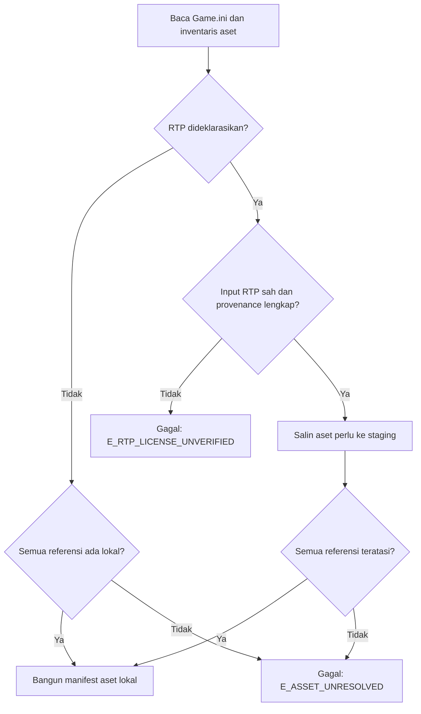
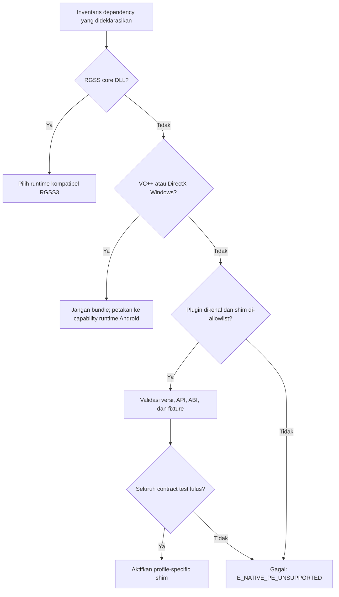
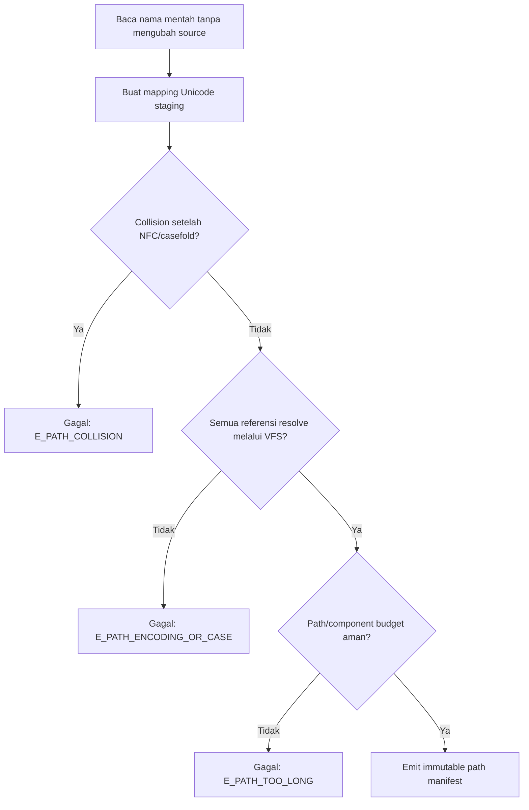
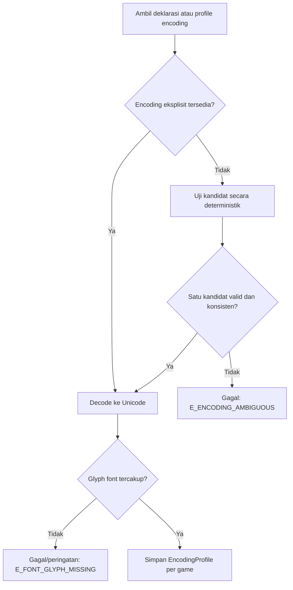
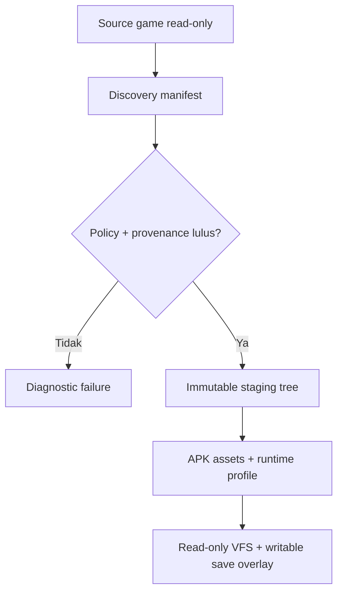

# Riset Teknis Evidence-First: MTool “Smart Fix”, RGSS3, dan mkxp-z

**Tanggal akses sumber:** 18 September 2026 (UTC)  
**Fokus utama:** RPG Maker VX Ace / RGSS3 dan mkxp-z  
**Pembanding:** RPG Maker XP / RGSS1 dan VX / RGSS2  
**Batas metode:** riset sumber publik dan rancangan observasi black-box legal. Tidak ada dekompilasi, disassembly, memory dumping, bypass proteksi, patching binary, atau akses data privat. Tidak ada pengujian MTool di Windows yang benar-benar dijalankan dalam riset ini.

---

## 1. Executive summary

1. **[VERIFIED FACT]** MTool secara resmi memasarkan Smart Fix dengan klaim “RTP? Missing DLL? Chinese paths? System language? Don't worry, we've got you covered.” Tutorial resminya meminta pengguna menyeret `Game.exe` ke MTool. Ini membuktikan permukaan produk dan alur peluncuran, bukan mekanisme internal tiap perbaikan. [MTool](https://mtool.app/) · [Tutorial resmi](https://mtool.app/tutorial.php)

2. **[VERIFIED FACT—pernyataan publik, belum direplikasi]** Dalam forum resmi MTool, akun yang tampak sebagai operator/pengembang menjelaskan arsitektur Windows sebagai dua bagian terpisah; pada awal peluncuran, karakteristik engine dideteksi dan sebuah DLL engine-specific dipilih untuk diinjeksi agar game terhubung ke MTool. Bukti ini berlaku untuk arsitektur integrasi/peluncuran Windows secara umum. **Bukti tersebut tidak membuktikan bahwa injeksi DLL adalah mekanisme Smart Fix untuk RTP, path, missing DLL, atau locale.** [Forum MTool: parameter peluncuran](https://bbs.mtool.app/topic/850/mtool%E5%90%AF%E5%8A%A8%E5%91%BD%E4%BB%A4%E6%98%AF%E5%90%A6%E6%9C%89%E5%8F%82%E6%95%B0/3)

3. **UNKNOWN:** tidak ada dokumentasi publik yang ditemukan yang menjelaskan apakah Smart Fix menyalin game ke path ASCII, memakai junction/symlink, short path 8.3, mengubah current working directory, memvirtualisasi registry, meng-hook API locale, atau memodifikasi source game. Tutorial membuktikan adanya fungsi cache, tetapi isi, lokasi, masa hidup, dan kaitannya dengan Smart Fix tidak dipublikasikan. [Tutorial resmi](https://mtool.app/tutorial.php)

4. **[VERIFIED FACT]** Mekanisme RTP engine lama dapat dipetakan tanpa bergantung pada MTool. RGSS1/RGSS2 mendeklarasikan RTP dan runtime library melalui `Game.ini`, mencari RTP melalui registry, dan mendahulukan DLL yang berada di folder game. Untuk VX Ace, bukti komunitas resmi dan implementasi kompatibel sangat kuat bahwa pola lanjutannya adalah `RGSS3\RTP`, value `RPGVXAce`, serta `Library=System\RGSS300.dll`; namun karena manual RGSS3 primer yang setara tidak ditemukan, rincian registrynya diklasifikasikan **[STRONG INFERENCE]**, bukan fakta primer.

5. **[VERIFIED FACT]** mkxp-z adalah reimplementasi/fork runtime RGSS yang terbuka dan menawarkan pola yang relevan: auto-detection versi RGSS, daftar path RTP eksplisit, cache path case-insensitive, patch/preload scripts, dan `gameFolder`. **UNKNOWN:** tidak ada bukti bahwa MTool memakai mkxp-z. Repositori mkxp-z juga tidak menyatakan Android sebagai target standalone resmi; integrasi Android harus divalidasi tersendiri. [mkxp-z](https://github.com/mkxp-z/mkxp-z) · [Konfigurasi mkxp-z](https://github.com/mkxp-z/mkxp-z/blob/dev/mkxp.json)

6. Untuk packager Android, desain paling aman adalah resolver bertahap dan fail-closed: deteksi RGSS3 secara read-only, bangun staging tree baru, selesaikan RTP hanya dari aset yang mempunyai provenance/lisensi jelas, tolak dependency native Windows yang tidak dikenal, pakai path Unicode internal dan VFS case-insensitive yang mendeteksi collision, lalu keluarkan laporan diagnostik deterministik. Jangan membawa DLL Windows ke APK dan jangan mengubah locale perangkat secara global.

7. Prioritas P0 adalah `RuntimeResolver`, `RtpAssetResolver`, `NativeDependencyClassifier`, normalisasi path/VFS, manifest provenance, dan fixture RGSS3. Encoding profile dan shim allowlist menyusul di P1; RGSS1/2 dan database kompatibilitas komunitas berada di P2.

---

## 2. Metode, definisi klasifikasi, dan batas kesimpulan

| Label | Arti operasional dalam laporan ini |
|---|---|
| **VERIFIED FACT** | Didukung dokumentasi resmi, pernyataan publik pihak MTool yang dikutip secara tepat, atau mekanisme platform yang dapat direproduksi. Untuk pernyataan forum, yang diverifikasi adalah *adanya pernyataan*, dan batas verifikasinya disebutkan. |
| **STRONG INFERENCE** | Konsisten dengan beberapa sumber teknis kuat atau pola engine, tetapi implementasi internal MTool tidak dipublikasikan atau belum diamati secara terkontrol. |
| **SPECULATION** | Mekanisme mungkin secara teknis, tetapi belum ada bukti yang membedakannya dari alternatif. Tidak boleh dijadikan dasar implementasi tanpa eksperimen. |
| **UNKNOWN** | Bukti tidak tersedia atau belum diperoleh. Ini bukan sinonim “tidak terjadi”. |

### Batas riset

- Tidak ada executable MTool atau fixture Windows yang dijalankan dalam lingkungan riset ini. Karena itu, bagian eksperimen adalah **protokol dan expected discriminator**, bukan hasil.
- Tidak ditemukan release note/changelog publik yang menerangkan Smart Fix secara rinci. Halaman rilis resmi hanya memberi paket, ukuran, timestamp/version code, dan deskripsi singkat.
- Kutipan sengaja pendek; konteks lengkap tersedia melalui URL sumber.
- Implikasi lisensi adalah panduan engineering, bukan nasihat hukum. Untuk distribusi komersial, minta tinjauan counsel dan simpan bukti hak distribusi per aset/dependency.

---

## 3. Jawaban A — Arsitektur umum MTool

### Temuan

- **[VERIFIED FACT]** Situs resmi menyatakan game dapat dijalankan dengan menyeretnya ke MTool dan pengaturan diselesaikan otomatis. Tutorial menunjuk `Game.exe` sebagai target drag-and-drop. Ini menempatkan setidaknya sebagian orkestrasi pada fase launch. [MTool](https://mtool.app/) · [Tutorial](https://mtool.app/tutorial.php)
- **[VERIFIED FACT—pernyataan publik, kredibilitas medium-high]** Akun `鬼才琪露诺` pada forum resmi menyatakan sistem terdiri dari tool dan modul injeksi yang terpisah, mendeteksi ciri engine saat start, lalu menentukan DLL yang digunakan. Akun tersebut berperilaku seperti operator/pengembang, tetapi perannya tidak dapat diverifikasi secara independen dari profil publik.
- **[STRONG INFERENCE]** Integrasi Windows aktif setidaknya saat launch dan selama runtime, karena modul yang digambarkan harus membuat game menemukan/terhubung ke MTool. Ini lebih dari sekadar pre-processing offline.
- **[VERIFIED FACT]** Tutorial memiliki tindakan **“Delete Cache and Reload”**. Jadi suatu cache aplikasi ada.
- **UNKNOWN:** apakah cache itu salinan game, hasil ekstraksi teks, indeks aset, hasil terjemahan, atau working tree Smart Fix.
- **UNKNOWN:** apakah MTool membuat wrapper launcher, working directory khusus, junction, symlink, short path, file konfigurasi tambahan, atau salinan penuh game.
- **UNKNOWN:** apakah source game asli ditulis atau tetap read-only. Jangan menyimpulkan dari tombol “Restore Original Text”; itu bukan bukti perubahan file sumber.
- **UNKNOWN:** apakah perbaikan Smart Fix persisten setelah MTool ditutup. Keberadaan cache hanya membuktikan state/cache aplikasi, bukan persistensi fix tertentu.
- **[VERIFIED FACT]** Paket resmi Android memisahkan runtime dan plugin engine; halaman rilis menyediakan plugin “RPG Maker XP/VX/VX Ace Support”.
- **[STRONG INFERENCE]** Perilaku integrasi berbeda per engine karena forum menggambarkan pemilihan DLL berdasarkan engine dan distribusi Android memakai plugin engine-specific. Rincian perbedaan Smart Fix tetap **UNKNOWN**. [Rilis resmi MTool](https://trs.mtool.app/release.php?lang=en)

### Kapan Smart Fix berjalan?

| Fase | Status bukti | Kesimpulan aman |
|---|---|---|
| Sebelum game | **STRONG INFERENCE** | Deteksi engine dinyatakan terjadi saat start; penyiapan dapat terjadi sebelum child process. Aksi Smart Fix spesifik belum diketahui. |
| Saat launch | **VERIFIED FACT—pernyataan publik** | Orkestrasi launch dan pemilihan modul engine-specific dijelaskan di forum resmi. |
| Saat runtime | **STRONG INFERENCE** | Modul dikatakan menghubungkan game dengan MTool; durasi dan fungsi Smart Fix tidak dipublikasikan. |
| Setelah exit/persisten | **UNKNOWN** | Harus diuji lewat diff file/registry, cache, dan relaunch normal setelah MTool ditutup. |

---

## 4. Jawaban B — RTP RPG Maker XP/VX/VX Ace

### 4.1 Model resmi/preserved-documented RGSS

RTP adalah paket bersama berisi grafik, musik, dan runtime DLL. Situs resmi RPG Maker menyatakan RTP mengurangi ukuran distribusi game; bila RTP tidak digunakan, material yang diperlukan harus disertakan dalam game. [RPG Maker RTP Downloads](https://www.rpgmakerweb.com/run-time-package)

| Engine | Deklarasi `Game.ini` | Registry logical view | Nama value lazim | Folder default terdokumentasi | Klasifikasi |
|---|---|---|---|---|---|
| XP / RGSS1 | `RTP1=Standard`, `RTP2=`, `RTP3=`; `Library=RGSS100J.dll` pada contoh Jepang | `HKLM\SOFTWARE\Enterbrain\RGSS\RTP` | `Standard` → path RTP | `[CommonFilesFolder]\Enterbrain\RGSS\[RTPName]` | **VERIFIED FACT** berdasarkan salinan help resmi yang dipreservasi; kredibilitas medium-high. |
| VX / RGSS2 | `RTP=RPGVX`; `Library=RGSS200E.dll` pada contoh | `HKLM\SOFTWARE\Enterbrain\RGSS2\RTP` | `RPGVX` → path RTP | `[CommonFilesFolder]\Enterbrain\RGSS2\[RTPName]` | **VERIFIED FACT** berdasarkan salinan help resmi yang dipreservasi; kredibilitas medium-high. |
| VX Ace / RGSS3 | lazimnya `RTP=RPGVXAce`; `Library=System\RGSS300.dll`; `Scripts=Data\Scripts.rvdata2` | `HKLM\SOFTWARE\Enterbrain\RGSS3\RTP` | `RPGVXAce` → path RTP | Instalasi resmi RTP; lokasi persis bergantung installer/edisi | **STRONG INFERENCE** dari forum resmi RPG Maker, beberapa implementasi kompatibel, dan pola RGSS1/2; manual RGSS3 primer setara tidak ditemukan. |

Sumber preserved help: [RGSS XP Specifications](https://www.rpg-maker.fr/dl/monos/aide/xp/source/rgss/rgss.html) dan [RGSS VX Specifications](https://www.rpg-maker.fr/dl/monos/aide/vx/source/rgss/rgss.html). Sumber VX Ace: [RPG Maker Forum—Define where the RTP path is](https://forums.rpgmakerweb.com/threads/define-where-the-rtp-path-is.19702/) dan [tapir issue—Game.ini options](https://github.com/qnighy/tapir/issues/10).

**Catatan registry 64-bit.** Path di tabel adalah path logis. Windows memisahkan view registry 32-bit dan 64-bit; `HKLM\SOFTWARE` termasuk area yang dialihkan. Aplikasi RGSS 32-bit pada Windows 64-bit biasanya melihat view yang alat 64-bit tampilkan di bawah `Wow6432Node`. Packager/observer harus membuka `Registry32`, bukan hard-code string `Wow6432Node`. [Registry Redirector](https://learn.microsoft.com/en-us/windows/win32/winprog64/registry-redirector) · [Shared Registry Keys](https://learn.microsoft.com/en-us/windows/win32/winprog64/shared-registry-keys)

### 4.2 Urutan pencarian dan kegagalan

- **[VERIFIED FACT, RGSS1/2]** `Game.ini` menyebut nama RTP dan library. Dokumentasi preserved menyatakan DLL di folder game didahulukan dari DLL di folder RTP/system location.
- **[VERIFIED FACT, RGSS1/2]** Jika RTP yang disebut tidak terpasang, engine menampilkan error.
- **[STRONG INFERENCE, RGSS3]** VX Ace meneruskan pola yang sama: `RTP=RPGVXAce`, runtime library di `System`, dan aset lokal dapat membuat build self-contained. Ini perlu fixture untuk mengonfirmasi setiap edisi/launcher.
- **[VERIFIED FACT]** Windows loader juga memiliki urutan pencarian DLL tersendiri. Karena itu, “DLL ditemukan” tidak otomatis berarti versi atau ABI benar. [Dynamic-link library search order](https://learn.microsoft.com/en-us/windows/win32/dlls/dynamic-link-library-search-order)
- **Failure ketika aset RTP hilang:** resolusi aset gagal dan game berhenti/menampilkan error; teks error tepat bergantung engine dan kode game.
- **Failure ketika RGSS DLL hilang:** stock `Game.exe` tidak dapat memuat runtime yang dinyatakan; bentuk error dapat berasal dari launcher/loader.

### 4.3 Apa yang dilakukan MTool terhadap RTP?

| Hipotesis | Status | Bukti saat ini | Observasi pembeda yang dibutuhkan |
|---|---|---|---|
| Mendeteksi RTP terpasang | **UNKNOWN** | Klaim Smart Fix menyebut RTP, tanpa detail. | `RegQueryValue` terhadap view RGSS3; reads pada folder RTP; keputusan berbeda saat key ada/tidak ada. |
| Mengarahkan ke RTP lokal | **UNKNOWN** | Tidak ada dokumentasi. | Read `Game.ini`/config buatan MTool; child process mengakses path lokal tanpa copy/install. |
| Menyalin aset yang dibutuhkan | **UNKNOWN** | Tidak ada file diff terkontrol. | Writes/hashes aset ke cache/staging; source hash tetap; manifest atau subset aset terbentuk. |
| Menyediakan paket RTP | **UNKNOWN** | Seorang pengguna melaporkan prompt missing RTP dan proses unzip/install, tetapi ini bukan observasi terkontrol. | Hash/nama/signature installer, URL asal, EULA, child process installer, writes registry/folder. |
| Mengubah `Game.ini` | **UNKNOWN** | Tidak ada bukti. | Hash dan byte diff `Game.ini` sebelum/sesudah; file system write trace. |
| Strategi lain | **SPECULATION** | Bisa berupa wrapper/runtime alternatif, virtual path, atau resolver in-process. | Trace registry/file/module/CWD yang meniadakan alternatif satu per satu. |

Satu thread forum resmi berisi laporan pengguna bahwa MTool memperingatkan RTP mungkin hilang, mengekstrak sesuatu, lalu mencoba instalasi. Jawaban akun operator-like menyatakan masalah RTP terpisah dari masalah `inject.exe` dan “usually ignore” masalah RTP. Ini membuktikan **adanya laporan publik**, bukan mekanisme, provenance paket, atau perilaku semua versi. [MTool forum—RTP/injected code issue](https://bbs.mtool.app/topic/949/mtool-issue-with-injected-code-unzipping-install)

### 4.4 Lisensi dan redistribusi RTP

- **[VERIFIED FACT]** Halaman RTP resmi memuat EULA end-user untuk XP/VX/VX Ace. Teks VX Ace melarang distribusi/transfer RTP atau datanya tanpa izin tertulis sebelumnya.
- Hak distribusi yang mungkin diperoleh pembuat game melalui lisensi produk/creator adalah isu terpisah. Packager tidak boleh mengasumsikan pengguna memiliki hak tersebut hanya karena RTP dapat diunduh gratis.
- Kebijakan build yang aman: terima RTP hanya sebagai input lokal dari pengguna/publisher; simpan deklarasi provenance, versi, hash, dan dasar lisensi; jangan mengunduh/menanamkan RTP otomatis tanpa grant yang dapat diaudit.
- mkxp-z dapat menjalankan aset tanpa stock Windows `RGSS300.dll`, tetapi hal itu tidak mengubah hak cipta aset RTP.

---

## 5. Jawaban C — “Missing DLL”

### 5.1 Apa arti istilah itu pada MTool?

**UNKNOWN.** Tidak ditemukan daftar resmi yang memetakan “missing DLL” pada tagline ke kategori dependency atau prosedur repair. Karena itu, tidak boleh menganggap semua DLL dapat diperbaiki.

Forum MTool juga memuat respons operator-like bahwa sebuah game tidak dapat didukung karena memakai library Windows. Itu adalah bukti konteks bahwa dukungan tidak universal, bukan kontrak dukungan formal. [Forum MTool—popular topics](https://bbs.mtool.app/popular?page=7&term=monthly)

### 5.2 Klasifikasi dependency yang aman

| Kategori | Contoh | Windows yang benar | Android equivalent | Kebijakan packager |
|---|---|---|---|---|
| RGSS runtime DLL | `RGSS300.dll`, `RGSS301.dll` | Disediakan oleh instalasi/runtime berlisensi atau secara app-local sesuai hak distribusi | Runtime reimplementation yang kompatibel, misalnya basis mkxp-z; **bukan** menjalankan/copy DLL Windows | Kenali sebagai runtime core; jangan tandai sebagai plugin umum. |
| Visual C++ runtime | `MSVCR*.dll`, `VCRUNTIME*.dll`, `MSVCP*.dll` | Installer resmi Microsoft atau app-local hanya bila lisensi redistribusi mengizinkan | NDK/C++ runtime yang menjadi dependency build Android sendiri | Jangan copy DLL Windows. Di Windows, arahkan ke installer resmi dan cocokkan arsitektur/versi. |
| DirectX legacy optional | `D3DX9_*.dll`, `XAudio2_7.dll`, `XInput1_3.dll`, XACT | DirectX End-User Runtimes/DirectSetup resmi untuk komponen side-by-side lama | SDL/OpenGL ES/Vulkan/OpenAL atau backend runtime Android | Jangan repack DLL; petakan capability, bukan nama file. |
| Game-specific native DLL | Mode7, codec, input, DRM, vendor SDK | Memerlukan binary yang sah dan ABI/API Windows yang cocok | Hanya shim/reimplementation yang diaudit dan di-allowlist | Unknown = unsupported; keluarkan daftar capability yang hilang. |
| Plugin/script bridge | `Win32API` calls, Ruby extension | Bergantung API Windows dan calling convention | Shim sempit, deklaratif, diuji per fungsi/game profile | Tidak ada “catch-all”. Tolak fungsi yang tidak terdaftar. |

### 5.3 Empat status distribusi

| Status | Definisi operasional | Contoh |
|---|---|---|
| **Safely redistributable** | Ada lisensi eksplisit yang mengizinkan distribusi target, provenance dan source notice lengkap, serta ABI cocok | Kode milik sendiri; dependency open-source yang kewajibannya dipenuhi. Bukan sinonim “tersedia di internet”. |
| **Requires user installation** | Vendor menyediakan installer resmi dan tidak ada hak/teknis untuk menanamkannya | VC++ Redistributable, DirectX legacy, dan RTP pada workflow Windows tertentu. Tidak relevan sebagai solusi dalam APK mandiri. |
| **Known compatibility shim** | Implementasi sempit, teruji, versioned, dan dipetakan pada kontrak API yang diketahui | Wrapper `Win32API` tertentu pada runtime kompatibel; harus tercatat dalam `ShimRegistry`. |
| **Unsupported/native dependency** | Binary/API tidak dikenal, Windows-only, berarsitektur salah, atau lisensinya tidak jelas | DLL game-specific yang tidak memiliki port/shim terverifikasi. Build gagal secara eksplisit. |

Microsoft menyatakan VC++ redistributable harus setidaknya setua/lebih baru dari toolset build dan redistribusinya tunduk pada lisensi Visual Studio. DirectX June 2010 hanya memasang library legacy side-by-side dan tidak mengganti core DirectX OS. [Latest VC++ Redistributable](https://learn.microsoft.com/en-us/cpp/windows/latest-supported-vc-redist?view=msvc-170) · [Redistributing Visual C++ Files](https://learn.microsoft.com/en-us/cpp/windows/redistributing-visual-cpp-files?view=msvc-170) · [DirectX End-User Runtimes](https://www.microsoft.com/en-us/download/details.aspx?id=8109) · [DirectX setup for game developers](https://learn.microsoft.com/en-us/windows/win32/dxtecharts/directx-setup-for-game-developers)

### 5.4 MTool: mekanisme yang boleh dan tidak boleh disimpulkan

- Menyediakan dependency resmi: **UNKNOWN**.
- Menggunakan wrapper/shim: **UNKNOWN**.
- Menghapus dependency opsional: **UNKNOWN**.
- Menggunakan mkxp-z: **UNKNOWN; tidak ada bukti.**
- Hanya diagnosis/link download: **UNKNOWN**.
- DLL injection sebagai arsitektur integrasi Windows: ada pernyataan publik langsung.
- DLL injection sebagai solusi “missing DLL”: **tidak terbukti dan tidak boleh dinyatakan sebagai fakta.**
- IAT hooking, proxy DLL, registry virtualization, locale API hooking: **UNKNOWN; tidak ada bukti langsung yang ditemukan.**

---

## 6. Jawaban D — Chinese/non-ASCII paths

### 6.1 Kegagalan umum yang terdokumentasi

| Titik gagal | Fakta platform | Gejala tipikal |
|---|---|---|
| `CreateFileA` / narrow `fopen` | `fopen` narrow memakai `CP_ACP` secara default; API `A` menerima string narrow. Karakter di luar code page bisa hilang/berubah. | File not found, nama mojibake, collision setelah konversi lossy. |
| `CreateFileW` / `_wfopen` | API wide menerima UTF-16 dan menghindari konversi ACP untuk nama path. | Mendukung CJK/emoji selama seluruh pipeline mempertahankan Unicode. |
| Current working directory | Launcher dapat menetapkan `lpCurrentDirectory`; game lama sering membuka relative path. | Jalan jika diluncurkan dari folder tertentu, gagal dari shortcut/launcher lain. |
| Argumen launcher | `CreateProcessA` memakai narrow strings; `CreateProcessW` wide. Quoting path berspasi tetap harus benar. | Path terpotong pada spasi atau karakter berubah. |
| Archive reader / extractor | Implementasi pihak ketiga mungkin menganggap entry name ANSI, UTF-8, atau encoding lokal. | Entry tidak ditemukan walau filesystem benar. Ini engine/tool-specific, bukan fakta universal. |
| Panjang path | `MAX_PATH` masih memengaruhi banyak API/aplikasi; dukungan long path perlu API wide dan opt-in manifest/policy tertentu. | Berhasil pada path pendek, gagal mendekati/melewati 260 karakter. |
| Short name 8.3 | `GetShortPathNameW` dapat memberi alias, tetapi short names tidak selalu tersedia pada NTFS dan tidak didukung seperti itu pada semua filesystem. | Workaround bekerja di satu volume namun gagal di volume/konfigurasi lain. |

Sumber: [`fopen`, `_wfopen`](https://learn.microsoft.com/en-us/cpp/c-runtime-library/reference/fopen-wfopen?view=msvc-170), [Windows code pages](https://learn.microsoft.com/en-us/windows/win32/intl/code-pages), [`CreateFileA`](https://learn.microsoft.com/en-us/windows/win32/api/fileapi/nf-fileapi-createfilea), [`CreateFileW`](https://learn.microsoft.com/en-us/windows/win32/api/fileapi/nf-fileapi-createfilew), [Maximum Path Length](https://learn.microsoft.com/en-us/windows/win32/fileio/maximum-file-path-limitation), [`CreateProcessW`](https://learn.microsoft.com/en-us/windows/win32/api/processthreadsapi/nf-processthreadsapi-createprocessw), dan [`GetShortPathNameW`](https://learn.microsoft.com/en-us/windows/win32/api/fileapi/nf-fileapi-getshortpathnamew).

### 6.2 Apa yang terbukti mengenai MTool?

| Mekanisme | Status | Catatan |
|---|---|---|
| Working path ASCII/cache copy | **UNKNOWN** | Keberadaan cache tidak membuktikan cache game atau path ASCII. |
| Junction/symlink | **UNKNOWN** | Tidak ada artefak reparse point yang dipublikasikan. |
| Short path 8.3 | **UNKNOWN** | Tidak ada command line/path trace. |
| Menyalin game ke cache | **UNKNOWN** | Tidak ada directory diff terkontrol. |
| Unicode API | **UNKNOWN** | Keberhasilan pada path CJK saja tidak cukup membuktikan API tertentu. |
| Mengubah CWD | **UNKNOWN** | Perlu event `Process Start`/command-line/CWD. |

Klaim “Chinese paths” resmi hanya membuktikan intent/hasil yang dipasarkan. Tidak menentukan layer tempat perbaikan dilakukan.

### 6.3 Matriks path fixture

Gunakan satu fixture milik sendiri dengan byte-identical content dan copy terpisah:

| ID | Contoh root | Risiko yang diuji | Expected discriminator |
|---|---|---|---|
| PATH-01 | `C:\RGSS3\Fixture` | Baseline ASCII | Harus menjadi kontrol sukses. |
| PATH-02 | `C:\RGSS3 Games\Fixture A` | Spasi/quoting | Kegagalan hanya di sini mengarah ke quoting/argument parsing. |
| PATH-03 | `C:\Café-Indonesia\Fixture` | Latin accented vs ACP | Bandingkan ACP 1252, 932, 936. |
| PATH-04 | `C:\中文\Fixture` | Simplified Chinese | Bedakan ACP-sensitive dari Unicode-safe. |
| PATH-05 | `C:\日本語\Fixture` | Japanese | Bandingkan ACP 932 dan non-932. |
| PATH-06 | `C:\Кириллица\Fixture` | Cyrillic | Uji karakter di luar ACP Barat/CJK. |
| PATH-07 | `C:\🎮-Fixture` | Surrogate pair/emoji | Uji pipeline UTF-16 penuh; 8.3/cache copy mudah terlihat. |
| PATH-08 | Root bertingkat dekat 260 dan >260 karakter | Long path | Catat panjang penuh, panjang komponen, policy, dan manifest behavior. |

**Belum ada hasil aktual untuk PATH-01…08.** Setiap baris harus dijalankan normal dan via MTool pada snapshot VM yang sama.

---

## 7. Jawaban E — System language/locale

### 7.1 Istilah yang harus dipisahkan

| Konsep | Scope | Dampak utama | API/konfigurasi representatif |
|---|---|---|---|
| Display/UI language | User/process/thread resource preference | Bahasa menu, dialog, resource UI | Preferred UI language APIs, `SetThreadUILanguage` |
| System locale / “language for non-Unicode programs” | Per-system | Menetapkan ANSI dan OEM code page default untuk aplikasi non-Unicode; perubahan normalnya memerlukan restart | Control Panel/intl config; `GetACP`, `GetOEMCP` membaca hasilnya |
| ANSI code page | System default untuk konversi narrow tertentu | Interpretasi byte `char` pada API `A`/CRT | `GetACP`, `CP_ACP` |
| OEM code page | System default untuk console/legacy OEM contexts | Konversi OEM legacy | `GetOEMCP`, `CP_OEMCP` |
| Thread locale | Per-thread locale identifier | Formatting, sorting, beberapa konversi `CP_THREAD_ACP`; bukan pengganti universal system locale | `Get/SetThreadLocale` |
| User locale | Per-user regional settings | Format angka/tanggal/sort default | `GetUserDefaultLCID` |
| System default LCID | Per-system locale setting | Locale default sistem; tidak identik dengan UI language | `GetSystemDefaultLCID` |
| Filesystem Unicode | Nama object filesystem melalui API wide | Kemampuan menyimpan/membuka nama Unicode | `CreateFileW`, `_wfopen`; terpisah dari UI language |

Microsoft secara eksplisit membedakan UI language, user locale, thread locale, dan language for non-Unicode programs. System locale mengontrol code page default untuk aplikasi non-Unicode dan bersifat per-system. [NLS Terminology](https://learn.microsoft.com/en-us/windows/win32/intl/nls-terminology) · [UI Language Management](https://learn.microsoft.com/en-us/windows/win32/intl/user-interface-language-management) · [SystemLocale](https://learn.microsoft.com/en-us/windows-hardware/customize/desktop/unattend/microsoft-windows-international-core-systemlocale)

### 7.2 Status bukti MTool

- Meminta perubahan locale Windows global: **UNKNOWN**.
- Menjalankan locale per-process: **UNKNOWN**.
- Meng-intercept `GetACP`, `GetOEMCP`, `GetSystemDefaultLCID`, `GetUserDefaultLCID`, atau `MultiByteToWideChar`: **UNKNOWN; tidak ada bukti langsung.**
- Menggunakan environment variables untuk locale: **UNKNOWN**.
- Game Jepang/China berjalan tanpa reboot dan tanpa perubahan global: **belum diuji**.
- IAT hooking/locale API hooking/registry virtualization: **tidak boleh dinyatakan sebagai fakta.**

`MultiByteToWideChar` menerima code page eksplisit seperti `CP_ACP`, `CP_THREAD_ACP`, atau `CP_UTF8`; keberhasilan sebuah game tidak mengungkap pilihan API/code page tanpa instrumentasi kode. [MultiByteToWideChar](https://learn.microsoft.com/en-us/windows/win32/api/stringapiset/nf-stringapiset-multibytetowidechar) · [GetACP](https://learn.microsoft.com/en-us/windows/win32/api/winnls/nf-winnls-getacp)

### 7.3 Cara menafsirkan observasi

- Jika system locale/ACP dan registry global berubah serta reboot diminta, itu bukti perbaikan global—dan desain tersebut tidak layak ditiru pada Android.
- Jika game bekerja tanpa reboot dan snapshot global identik, itu menolak hipotesis perubahan global, **tetapi tidak membuktikan** locale API hooking. Alternatifnya termasuk working copy bernama ASCII, data transcoding, runtime Unicode, config override, atau proses emulator/compatibility layer.
- Mojibake UI saja dapat berasal dari decode string salah atau font tanpa glyph. Pisahkan byte decoding dari glyph coverage.
- Nama file mojibake harus ditelusuri pada tiga lapis: bytes di archive/script, mapping ke Unicode, dan lookup VFS/filesystem.

---

## 8. Evidence matrix

| Claim | Classification | Evidence | Source | Confidence | Open Question |
|---|---|---|---|---|---|
| MTool memasarkan Smart Fix untuk RTP, missing DLL, Chinese paths, dan system language | **VERIFIED FACT** | Kutipan identik pada halaman resmi | [MTool](https://mtool.app/) | High | Versi/engine mana dan batas dukungannya? |
| Alur resmi: drag `Game.exe` ke MTool | **VERIFIED FACT** | Tutorial resmi | [Tutorial](https://mtool.app/tutorial.php) | High | Command line/CWD apa yang dipakai? |
| Arsitektur Windows memilih DLL engine-specific dan melakukan injection | **VERIFIED FACT—public statement** | Pernyataan akun operator-like di forum resmi | [Forum parameter](https://bbs.mtool.app/topic/850/mtool%E5%90%AF%E5%8A%A8%E5%91%BD%E4%BB%A4%E6%98%AF%E5%90%A6%E6%9C%89%E5%8F%82%E6%95%B0/3) | Medium-high | Reproduksi Procmon/modules; apakah semua versi memakai pola sama? |
| Injection tersebut adalah mekanisme Smart Fix locale/RTP/path | **SPECULATION** | Tidak ada pemetaan fungsi ke Smart Fix | Sama | Low | Modul mana melakukan apa? |
| MTool memiliki cache | **VERIFIED FACT** | Tombol “Delete Cache and Reload” | [Tutorial](https://mtool.app/tutorial.php) | High | Isi/lokasi/lifetime/cache scope? |
| MTool menyalin game ke cache ASCII | **SPECULATION** | Tidak ada directory diff | — | Low | Apakah child image/CWD pindah? |
| MTool memodifikasi source game | **UNKNOWN** | Tidak ada hash/diff terkontrol | — | — | File apa ditulis dan apakah pulih setelah exit? |
| Perbaikan persisten setelah MTool exit | **UNKNOWN** | Cache bukan bukti persistence fix | — | — | Normal relaunch dan reboot behavior? |
| Paket Android MTool memisahkan runtime dan plugin XP/VX/VX Ace | **VERIFIED FACT** | Halaman rilis resmi | [Release](https://trs.mtool.app/release.php?lang=en) | High | Runtime internal dan lisensi komponennya? |
| MTool memakai mkxp-z | **UNKNOWN** | Tidak ada sumber yang ditemukan | — | — | SBOM, notices, atau pernyataan developer? |
| RGSS1/2 membaca RTP dari `Game.ini` dan registry | **VERIFIED FACT** | Help engine preserved | [XP](https://www.rpg-maker.fr/dl/monos/aide/xp/source/rgss/rgss.html) · [VX](https://www.rpg-maker.fr/dl/monos/aide/vx/source/rgss/rgss.html) | Medium-high | Variasi edisi/language? |
| VX Ace memakai logical key `RGSS3\RTP`, value `RPGVXAce` | **STRONG INFERENCE** | Forum resmi + pola engine + implementasi kompatibel | [RPG Maker forum](https://forums.rpgmakerweb.com/threads/define-where-the-rtp-path-is.19702/) | High | Konfirmasi installer/Procmon per edisi. |
| `Wow6432Node` adalah view fisik 32-bit, bukan key logis portable | **VERIFIED FACT** | Dokumentasi registry redirector | [Microsoft](https://learn.microsoft.com/en-us/windows/win32/winprog64/registry-redirector) | High | Tool observasi membuka view mana? |
| User pernah melihat prompt RTP dan install/unzip dari MTool | **VERIFIED FACT tentang laporan publik** | Post pengguna pada forum resmi | [Thread RTP](https://bbs.mtool.app/topic/949/mtool-issue-with-injected-code-unzipping-install) | Medium-low | Paket apa, versi apa, asal/lisensi apa? |
| MTool menyediakan RTP legal untuk semua game | **UNKNOWN** | Laporan pengguna tidak membuktikan paket/provenance | — | — | Hash, signature, EULA, URL download? |
| EULA RTP end-user membatasi redistribusi | **VERIFIED FACT** | EULA pada situs resmi | [RTP Downloads](https://www.rpgmakerweb.com/run-time-package) | High | Hak creator/publisher spesifik proyek? |
| “Missing DLL” mencakup RGSS/VC++/DirectX/plugin semuanya | **UNKNOWN** | Marketing tidak mendefinisikan kategori | — | — | Error taxonomy resmi? |
| Sebagian library Windows tidak didukung MTool | **VERIFIED FACT—public response** | Respons operator-like pada forum | [Popular topics](https://bbs.mtool.app/popular?page=7&term=monthly) | Medium | Library dan versi spesifik? |
| Narrow CRT/API dapat gagal pada path di luar ACP | **VERIFIED FACT** | Dokumentasi Microsoft | [`fopen`](https://learn.microsoft.com/en-us/cpp/c-runtime-library/reference/fopen-wfopen?view=msvc-170) · [Code pages](https://learn.microsoft.com/en-us/windows/win32/intl/code-pages) | High | Fungsi apa yang benar-benar dipanggil game/MTool? |
| MTool memakai 8.3/junction/Unicode/CWD override | **UNKNOWN** | Tidak ada direct observation | — | — | PATH-01…08 + trace. |
| System locale berbeda dari UI/thread/user locale | **VERIFIED FACT** | Dokumentasi NLS Microsoft | [NLS terminology](https://learn.microsoft.com/en-us/windows/win32/intl/nls-terminology) | High | Setting mana yang MTool tangani? |
| MTool melakukan locale API hooking | **SPECULATION** | Tidak ada bukti API-level | — | Low | Dibutuhkan observasi yang melampaui Procmon; tetap hindari reverse engineering. |
| mkxp-z mendukung auto RGSS detection, RTP paths, case-insensitive path cache | **VERIFIED FACT** | Konfigurasi/repo upstream | [mkxp.json](https://github.com/mkxp-z/mkxp-z/blob/dev/mkxp.json) | High | Perilaku build/branch yang dipilih? |
| mkxp-z standalone resmi mendukung Android | **UNKNOWN** | Upstream mencantumkan Windows/Linux/macOS, bukan Android | [mkxp-z](https://github.com/mkxp-z/mkxp-z) | Medium-high | Fork/backend Android mana yang dipilih dan diuji? |

---

## 9. Tabel per masalah

| Problem | Observed MTool behavior | Verified mechanism | Possible mechanisms | Android equivalent |
|---|---|---|---|---|
| RTP missing | Klaim resmi; satu laporan pengguna melihat prompt + unzip/install | Tidak ada mekanisme MTool terverifikasi | Registry detection, installer resmi, local RTP path, copy subset, alternative resolver | `RtpAssetResolver` memakai input berlisensi dan staging manifest |
| RGSS DLL missing | Klaim “missing DLL” umum | Tidak ada definisi kategori MTool | Menemukan stock runtime, repair/install, atau replacement runtime | `RuntimeResolver` memilih runtime kompatibel; jangan bundle DLL Windows |
| VC++ runtime missing | Tidak didokumentasikan spesifik oleh MTool | Installer/licensing Microsoft terdokumentasi | Diagnosis/link installer pada Windows | Dependency native Android dibangun sendiri dan dicatat SBOM |
| DirectX legacy missing | Tidak didokumentasikan spesifik | Paket DirectX legacy resmi tersedia untuk Windows | Diagnosis/install resmi | Backend SDL/GLES/Vulkan/audio; capability mapping |
| Custom/plugin DLL | Forum mengindikasikan library Windows tertentu bisa unsupported | Tidak ada shim matrix publik | Exact shim, partial reimplementation, atau unsupported | Fail closed kecuali allowlisted `ShimRegistry` |
| Chinese/CJK path | Klaim resmi | Tidak ada path mechanism terverifikasi | Unicode API, ASCII copy, short path, junction, CWD override | Unicode staging + raw-name manifest + VFS lookup |
| Space in path | Tidak ada observasi publik terkontrol | Windows quoting/CWD rules terdokumentasi | Correct quoting or working-directory wrapper | Tidak lewat shell; gunakan argv terstruktur/internal URI |
| Long path | Tidak ada observasi publik | Win32 long-path constraints terdokumentasi | Shorter cache root atau wide/long-path aware process | Internal app storage; enforce component/path budget at build |
| System language | Klaim resmi | Tidak ada locale mechanism terverifikasi | Per-process runtime, transcoding, ASCII staging, compatibility environment | Explicit `EncodingProfile`; tidak mengubah device locale |
| Mojibake/font | Tidak ada pemetaan MTool publik | Decode dan font coverage adalah layer terpisah | Codepage conversion, font fallback | Charset decoder + glyph coverage check + licensed font policy |
| Case mismatch | Tidak disebut pada tagline | mkxp-z menyediakan lower-case path index option | Case-insensitive resolver | `CaseInsensitiveVFS` dengan collision detection |

---

## 10. Compatibility decision tree

### 10.1 RTP / aset bersama



Aturan: jangan memasang RTP global di Android; jangan menyentuh source tree; setiap file staging menyimpan hash dan provenance.

### 10.2 DLL / native dependency



Aturan: nama file bukan bukti kompatibilitas. Hash/version/API contract dan lisensi harus cocok.

### 10.3 Unicode path



Aturan: simpan nama asli dan nama canonical secara terpisah. Jangan diam-diam memilih salah satu dari dua file yang bertabrakan setelah casefold/normalisasi.

### 10.4 Locale / encoding



Aturan: tidak ada perubahan global locale Android. Formatting UI aplikasi host juga tidak boleh dipakai sebagai decoder data game.

---

## 11. F — Rencana observasi black-box legal dan reproducible

### 11.1 Lingkungan uji

1. Buat VM Windows 11 disposable dengan snapshot bersih; catat build OS, arsitektur, filesystem, policy long path, dan status pembuatan short name 8.3.
2. Gunakan salinan MTool resmi dan catat URL, versi/timestamp, SHA-256, serta signature publisher. Jangan ambil dari mirror tidak resmi.
3. Buat fixture VX Ace milik sendiri yang minimal dan legal. Jangan memakai game pihak ketiga atau archive berproteksi.
4. Buat empat varian konten yang jelas:
   - `F-RGSS3-LOCAL`: `RTP=` kosong, semua aset minimal lokal.
   - `F-RGSS3-RTP`: `RTP=RPGVXAce`, satu aset RTP yang hak ujinya telah dipastikan.
   - `F-RGSS3-MISSING-LIB`: `Library` menunjuk nama yang sengaja tidak ada.
   - `F-RGSS3-NATIVE`: plugin DLL benign milik sendiri dengan deklarasi yang terkendali; tidak memuat payload berbahaya.
5. Gandakan tiap varian ke PATH-01…PATH-08. Pastikan konten byte-identical dengan manifest SHA-256.
6. Buat dua snapshot locale minimum: system locale Jepang/ACP 932 dan English/ACP 1252; opsional Simplified Chinese/936. Jangan mengubah setting di tengah run tanpa snapshot/reboot yang tercatat.

### 11.2 Baseline yang dicatat

| Domain | Data mentah minimum |
|---|---|
| Folder fixture | Relative path, size, mtime, SHA-256; reparse tag; ACL bila relevan |
| Folder MTool/app data | Tree + hash sebelum run; `%TEMP%`, `%LOCALAPPDATA%`, `%APPDATA%` yang relevan |
| Registry | Kedua view 32/64-bit untuk `HKLM\SOFTWARE\Enterbrain\RGSS*\RTP`; user/system intl keys hanya read-only snapshot |
| Locale | Display/UI language, user locale, system locale, ACP, OEMCP, timezone |
| Environment | PATH, TEMP/TMP, current directory, long-path policy; redaksi secrets |
| Processes | PID/PPID, image path, command line, current directory, integrity level, signer |
| Modules | Full path, size, hash, signer, load time untuk module di proses MTool/game |
| Network | Kosong secara default; capture hanya bila perilaku tak dapat dijelaskan atau download terjadi |

### 11.3 Alat dan konfigurasi

- **Process Monitor:** filter pada process tree MTool/game/child, lalu operasi `Process Create`, `Load Image`, `CreateFile`, `QueryOpen`, `ReadFile`, `WriteFile`, rename/delete, `RegOpenKey`, `RegQueryValue`, dan `RegSetValue`. Procmon secara resmi menangkap aktivitas filesystem, registry, process/thread, serta process tree. [Process Monitor](https://learn.microsoft.com/en-us/sysinternals/downloads/procmon)
- **Process Explorer:** verifikasi parent/child, image path, command line, signer, handles, dan loaded DLL/module. [Process Explorer](https://learn.microsoft.com/en-us/sysinternals/downloads/process-explorer)
- **Event Viewer:** Application Error, Windows Error Reporting, SideBySide, .NET Runtime bila relevan.
- **Directory/hash diff:** `Get-FileHash` memakai SHA-256 secara default; simpan CSV/JSON manifest sebelum dan sesudah. [Get-FileHash](https://learn.microsoft.com/en-us/powershell/module/microsoft.powershell.utility/get-filehash?view=powershell-7.5)
- **Registry diff:** ambil kedua registry views secara eksplisit; jangan hanya mengekspor view default alat. `reg export` dapat menyimpan key ke `.reg`, tetapi view harus dikontrol oleh proses/metode pengambilan. [reg export](https://learn.microsoft.com/en-us/windows-server/administration/windows-commands/reg-export)
- **Network capture:** hanya jika installer/download terlihat. Catat domain, IP, TLS SNI/sertifikat, waktu, ukuran, dan hash file hasil; jangan menangkap credential atau konten privat.

### 11.4 Urutan eksperimen

| ID | Prosedur | Expected observation | Interpretasi yang sah |
|---|---|---|---|
| EXP-01 | Snapshot; jalankan fixture normal; tutup; snapshot | Baseline failure/success, file/registry reads, loader error | Menentukan masalah tanpa MTool. |
| EXP-02 | Restore snapshot; jalankan fixture via MTool | Child tree, command line, CWD, loads, writes | Menentukan delta karena MTool. |
| EXP-03 | Ulangi dengan `F-RGSS3-RTP`, key RTP ada vs tidak | Query registry, read folder RTP, prompt/installer | Membedakan deteksi registry, local path, atau installer. |
| EXP-04 | Ulangi `F-RGSS3-MISSING-LIB` | Error, download/process installer, module resolution | Menguji apa yang dimaksud “missing DLL”; tidak menggeneralisasi hasil. |
| EXP-05 | PATH-01…08 normal dan via MTool | Image path, CWD, actual opened paths, success/failure | Membedakan path/quoting/length behavior. |
| EXP-06 | ACP 1252 vs 932, bytes fixture tetap | Mojibake, file lookup, script parse, font glyph | Membedakan ketergantungan ACP; bukan bukti hook API. |
| EXP-07 | Tutup MTool; jalankan game normal lagi | Hash/source/registry dan behavior after exit | Menilai persistence. |
| EXP-08 | Reboot dan ulangi normal launch | State surviving reboot | Memisahkan temp/runtime state dari perubahan persisten. |
| EXP-09 | Uji plugin benign milik sendiri | Load Image, error, child process | Memetakan satu dependency, bukan klaim universal. |
| EXP-10 | Jika muncul download | Endpoint, signature, hash, EULA | Menetapkan provenance; hentikan jika syarat/lisensi tidak jelas. |

### 11.5 Discriminator mekanisme

| Dugaan mekanisme | Pola observasi yang mendukung | Apa yang belum dapat dibuktikan |
|---|---|---|
| Copy ke cache ASCII | Read tree asli diikuti write tree ke root ASCII; child image/CWD/open paths berada di copy | Alasan copy dan kode internal yang memilihnya |
| Junction/symlink | Directory entry/reparse point baru; target mengarah ke source/cache; metadata reparse dapat dibaca | Siapa yang membuat bila trace tidak lengkap |
| Short path 8.3 | Command line/CWD/open path berisi alias `~1`; alias cocok hasil query volume | Tidak tersedia universal; hasil sukses satu volume tidak general |
| CWD override | Image tetap di source, tetapi Process Start mencatat CWD berbeda; relative opens resolve dari sana | Implementasi API spesifik bila tidak ada code trace |
| Unicode-capable launch | Original CJK/emoji path dibuka langsung, tanpa alias/copy, dan berhasil | Tidak membuktikan `CreateFileW`; bisa ada konversi/wrapper lain |
| RTP installer | Child installer, signature/hash, file writes ke lokasi RTP, registry set | Legalitas redistribusi tanpa EULA/provenance |
| Local RTP redirect | Tidak ada install/write; reads diarahkan ke folder yang disiapkan MTool | Apakah via config, hook, atau runtime resolver |
| Global locale change | Intl registry/system setting berubah dan reboot/logoff diminta | Tidak otomatis menjelaskan seluruh perbaikan |
| Non-global locale behavior | Global snapshot identik, tidak ada reboot, game berhasil | Tidak membuktikan API hooking; banyak alternatif tetap terbuka |
| Source mutation | Hash/bytes source berubah dan trace menunjukkan write/rename | Semantik perubahan tanpa inspeksi lebih lanjut |
| Runtime-only fix | Source/registry identik; game hanya berhasil saat MTool aktif | Layer internal persisnya tetap unknown |

### 11.6 Keterbatasan observasi

- Procmon/Process Explorer tidak membuktikan pemanggilan `GetACP`, `GetOEMCP`, `GetSystemDefaultLCID`, `GetUserDefaultLCID`, atau `MultiByteToWideChar` tertentu.
- Ketiadaan event registry tidak membuktikan registry virtualization; yang dapat dikatakan hanya “tidak terlihat pada trace ini”.
- Mengidentifikasi API hook secara definitif biasanya memerlukan instrumentation/debugging/code inspection yang berada di luar scope. Tetapkan **UNKNOWN**, jangan memaksa kesimpulan.
- Antivirus dapat mengubah hasil. Catat produk, versi, dan alert; jangan mematikan proteksi kecuali di VM terisolasi dan kebijakan lab mengizinkan.
- Jalankan sedikitnya tiga kali per kondisi setelah restore snapshot; random cache/timing harus dipisahkan dari efek yang konsisten.

### 11.7 Skema data mentah

Simpan satu folder hasil per run:

```text
RUN_ID/
  manifest.json
  environment.json
  process-tree.csv
  loaded-modules.csv
  procmon.pml
  procmon-filter.xml
  files-before.csv
  files-after.csv
  registry32-before.reg-or-json
  registry32-after.reg-or-json
  registry64-before.reg-or-json
  registry64-after.reg-or-json
  events.evtx
  network-metadata.json   # hanya bila diperlukan
  observer-notes.md
```

Field minimum `manifest.json`:

```json
{
  "run_id": "EXP-05_PATH-04_ACP-1252_MTOOL_R1",
  "fixture_id": "F-RGSS3-LOCAL",
  "fixture_sha256_manifest": "<hash>",
  "mtool_version": "<exact value>",
  "mtool_sha256": "<hash>",
  "os_build": "<value>",
  "system_locale": "<value>",
  "acp": 1252,
  "oemcp": 437,
  "launch_mode": "mtool",
  "start_utc": "<ISO-8601>",
  "end_utc": "<ISO-8601>",
  "result": "success|failure|partial",
  "observer_conclusion": "<bounded statement>",
  "unknowns": []
}
```

Kolom `process-tree.csv`: `utc,pid,ppid,image_path,command_line,current_directory,integrity_level,signer,sha256`.  
Kolom `loaded-modules.csv`: `utc,pid,module_path,base_name,file_version,signer,sha256`.  
Kolom file diff: `relative_path,raw_name_encoding_if_known,size,mtime_utc,sha256,reparse_tag,status_added_changed_deleted`.

### 11.8 Larangan selama eksperimen

Tidak melakukan dekompilasi, disassembly, memory dump, bypass lisensi/proteksi, debugger attach, patching binary, credential capture, atau penggunaan game pihak ketiga tanpa izin. Jangan mengunggah capture yang mungkin memuat username/path privat sebelum redaksi.

---

## 12. G — Desain Android “RuntimePack Smart Resolver”

### 12.1 Prinsip pipeline

1. **Discovery (read-only):** identifikasi engine, konfigurasi, referensi aset, nama dependency, encoding candidates, collision, dan lisensi/provenance. Tidak menulis source.
2. **Build (staging):** buat tree baru deterministik; materialisasi aset yang diizinkan; bangun index VFS; pilih runtime/shim exact; hasilkan SBOM dan diagnostic report.
3. **Runtime:** mount packaged data read-only, overlay save/config di app-private storage, jalankan resolver Unicode/case-insensitive, dan aktifkan hanya shim yang tercantum manifest.

Data flow ringkas:



### 12.2 Modul, kontrak, failure mode, dan fixture

| Module | Phase | Input → output | Failure mode / diagnostic code | Test fixture | Lisensi/provenance | Scope |
|---|---|---|---|---|---|---|
| **RuntimeResolver** | Discovery + build | `Game.ini`, extension data/script, explicit override → `{engine: RGSS3, runtime_id, version}` | `E_ENGINE_UNKNOWN`, `E_ENGINE_CONFLICT`, `E_RUNTIME_UNAVAILABLE` | RGSS3 standard; renamed executable; conflicting markers; minimal XP/VX comparator | Runtime version, source commit, build flags, license notices | Generic detection; override profile-specific |
| **RtpAssetResolver** | Discovery + build | RTP declaration, local asset index, user-supplied licensed RTP root → staged asset map | `E_RTP_MISSING`, `E_RTP_LICENSE_UNVERIFIED`, `E_ASSET_UNRESOLVED`, `E_ASSET_HASH_MISMATCH` | RTP blank/local; `RPGVXAce` present/absent; one missing referenced asset | Per-file source, owner/license basis, source hash, transform record | Generic resolver; catalog per engine |
| **NativeDependencyClassifier** | Discovery | Declared DLL/plugin names, explicit manifest, known hashes/metadata → category/capability decision | `E_NATIVE_PE_UNSUPPORTED`, `E_NATIVE_UNKNOWN`, `E_ABI_MISMATCH`, `E_DEP_LICENSE_UNKNOWN` | RGSS300; known VC/DirectX names; benign custom DLL; unknown renamed file | Never infer license from filename; exact package/version/hash | Generic policy; compatibility result profile-specific |
| **EncodingProfile** | Discovery + build + runtime | Explicit override or bounded candidate test over `UTF-8`, Windows-932, Windows-936, etc. → decoder/profile | `E_ENCODING_AMBIGUOUS`, `E_DECODE_INVALID`, `W_LOSSY_DECODE_FORBIDDEN`, `E_FONT_GLYPH_MISSING` | Japanese bytes, Chinese bytes, UTF-8, deliberately ambiguous ASCII-only, invalid sequence | Decoder implementation/license; font provenance separate | Framework generic; chosen profile per game |
| **UnicodePathNormalizer** | Build | Raw source name + decoded Unicode → immutable original/canonical mapping | `E_PATH_DECODE`, `E_PATH_COLLISION`, `E_PATH_COMPONENT_TOO_LONG`, `E_RESERVED_NAME` | CJK, Cyrillic, emoji, composed/decomposed `é`, traversal token, long component | Preserve raw bytes/name metadata; no silent rename | Generic |
| **CaseInsensitiveVFS** | Build + runtime | Canonical path index + asset packages → Windows-like lookup map | `E_CASE_COLLISION`, `E_VFS_AMBIGUOUS`, `E_ASSET_NOT_FOUND` | `Graphics/A.png` vs `graphics/a.png`; mixed slash; extension case | Index records source hash and chosen canonical key | Generic; collision exception never automatic |
| **CompatibilityDatabase** | Discovery + build | Engine/version, game/profile hash, dependency set → signed compatibility profile | `E_PROFILE_SIGNATURE`, `E_PROFILE_STALE`, `E_PROFILE_CONFLICT` | Known profile, tampered signature, engine upgrade, hash mismatch | Signed origin, reviewer, version, expiry, evidence links | Infra generic; entries profile-specific |
| **ShimRegistry** | Build + runtime | Required API/capability + exact profile → allowlisted shim modules | `E_SHIM_NOT_ALLOWLISTED`, `E_SHIM_VERSION`, `E_SHIM_CONTRACT`, `E_SHIM_LICENSE` | Supported `Win32API` subset; unknown function; wrong argument contract | Source, license, SBOM, test suite, API contract | Deliberately game/API-specific |
| **DiagnosticReport** | All | Semua decisions/evidence → JSON + human-readable report | `E_REPORT_INCOMPLETE`; build harus gagal bila error teredaksi/hilang | Golden report tests; reproducible build comparison | Menyertakan provenance tetapi meredaksi path/PII saat dibagikan | Generic |

### 12.3 Detail implementasi yang disarankan

#### RuntimeResolver

- Prioritaskan deklarasi eksplisit dan kombinasi marker: `Scripts=Data\Scripts.rvdata2`, format data `.rvdata2`, dan library RGSS3.
- Bila sinyal bertentangan, jangan fallback diam-diam. Minta profile override yang tercatat.
- mkxp-z memiliki `rgssVersion=0` untuk auto-guess dan fallback ke RGSS1; untuk packager produksi, fallback diam-diam itu sebaiknya diganti error agar APK tidak terlihat “berhasil build” dengan runtime salah.
- Simpan `runtime_id`, commit/tag, toolchain, ABI, feature flags, dan license bundle di manifest.

#### RtpAssetResolver

- Parser `Game.ini` harus mempertahankan bytes asli, line ending, dan key/value untuk diagnosis. Encoding file INI lama bisa bergantung ACP; jangan mengasumsikan UTF-8.
- Bangun graph referensi hanya dari format/source yang sah dan didukung. Jangan membongkar archive terproteksi atau format privat tanpa izin/dokumentasi.
- Urutan resolusi yang disarankan: local game asset → explicit project override → licensed RTP input. Jangan mengandalkan registry Windows saat membangun APK.
- Copy ke staging hanya aset yang diperlukan bila lisensi mengizinkan subset; jika ketentuan mewajibkan paket utuh atau melarang distribusi, ikuti lisensi atau gagal.

#### NativeDependencyClassifier

- Default deny. Nama `foo.dll` sendiri tidak membuktikan API, arsitektur, atau hak distribusi.
- Metadata standar seperti PE machine type/import names dapat dipakai hanya bila kebijakan proyek mengizinkan inspeksi dependency metadata; tidak perlu decompile/disassemble. Jika batas legal tidak jelas, minta deklarasi developer dan tetap fail closed.
- Klasifikasikan capability (`graphics.mode7`, `win32.file-dialog`, `codec.xyz`), bukan sekadar filename. Ini memungkinkan shim yang sempit dan testable.

#### EncodingProfile dan path

- Jangan “deteksi” encoding dari bytes ASCII-only; hasilnya ambigu. Simpan explicit profile atau tunggu sample yang membedakan.
- Decode sekali pada boundary ke Unicode; jangan bolak-balik melalui default locale Android.
- Pertahankan Unicode original display name dan canonical lookup key. NFC/casefold hanya untuk index; jangan mengubah data script semaunya.
- Collision adalah error yang meminta keputusan developer, bukan “first file wins”.

#### Save overlay

- APK/source assets bersifat immutable. Save, config runtime, screenshot, dan cache masuk app-private writable overlay.
- Gunakan ID game stabil berbasis manifest, bukan absolute source path.
- Laporan harus membedakan file packaged read-only dari file yang dibuat user/runtime.

### 12.4 Posisi mkxp-z

- **[VERIFIED FACT]** Upstream menyebut mkxp-z sebagai fork/reimplementation lintas platform untuk RGSS dan mengakui sebagian game memerlukan porting work. Target yang dicantumkan adalah Windows, Linux, dan macOS. [mkxp-z repository](https://github.com/mkxp-z/mkxp-z)
- **[VERIFIED FACT]** `mkxp.json` menyediakan `gameFolder`, `rgssVersion`, RTP path list, preload scripts, dan `pathCache` yang mengindeks path lower-case untuk emulasi case-insensitive. [mkxp.json](https://github.com/mkxp-z/mkxp-z/blob/dev/mkxp.json)
- **[VERIFIED FACT]** Dokumentasi Libretro mkxp-z menunjukkan RTP directory per engine dan menyatakan file DLL/icon tidak dibutuhkan oleh core tersebut. Ini berguna sebagai pola replacement runtime, bukan bukti MTool. [Libretro mkxp-z](https://docs.libretro.com/library/mkxp-z/)
- **Lisensi:** repo menyatakan GPLv2+; konfigurasi default dengan HTTPS/OpenSSL dapat membuat binary efektif GPLv3 menurut catatan upstream. APK, source offer, notices, relinking/build scripts, serta compatibility library harus ditinjau terhadap distribusi yang dipilih.
- **UNKNOWN:** kesiapan Android standalone, input/audio/lifecycle/storage/scoped-storage, JNI/NDK build, dan kompatibilitas seluruh RGSS3. Buat proof-of-concept legal dengan fixture sendiri sebelum menyebut target supported.

---

## 13. Prioritas fitur “RuntimePack Smart Resolver”

### P0 — milestone RGSS3 yang harus ada sebelum klaim kompatibilitas

1. `RuntimeResolver` deterministik untuk VX Ace/RGSS3 dengan explicit override dan fail-on-conflict.
2. `RtpAssetResolver` dengan input lokal, provenance, hash, dan policy lisensi; tidak ada auto-download RTP.
3. Build staging immutable; source tree selalu read-only dan diverifikasi hash sebelum/sesudah.
4. `NativeDependencyClassifier` default-deny: stock RGSS core dipetakan ke runtime kompatibel; unknown DLL menghentikan build.
5. Unicode internal path model + `CaseInsensitiveVFS` + deteksi NFC/casefold collision.
6. Parser `Game.ini` byte-preserving dan support path separator Windows secara virtual.
7. Diagnostic JSON + Markdown dengan code stabil: engine, RTP, dependency, encoding, path, license, dan remediation.
8. Fixture suite: local-only, RTP-required, missing library, custom DLL, case collision, CJK/emoji/long path.
9. SBOM/runtime provenance dan reproducible build inputs.
10. Android proof-of-concept mkxp-z-derived runtime dengan lifecycle/input/audio/storage tests; jangan klaim official Android support sebelum lulus.

### P1 — compatibility depth

1. `EncodingProfile` explicit-first dengan kandidat Windows-932/936/1252/UTF-8 dan ambiguity error.
2. Font glyph coverage check dan kebijakan font fallback berlisensi.
3. `ShimRegistry` berkontrak sempit untuk Win32API calls yang benar-benar dibutuhkan fixture/game profile.
4. `CompatibilityDatabase` bertanda tangan, versioned, berisi evidence dan expiry.
5. Asset reference audit dan laporan unresolved path dengan nearest-case match—tanpa membuat dummy asset.
6. Save migration/versioning dan read-only base + writable overlay.
7. Regression matrix device/Android API level/ABI/GPU/audio.

### P2 — perluasan setelah RGSS3 stabil

1. Resolver RGSS1/XP dan RGSS2/VX sebagai profil terpisah, bukan heuristik campuran.
2. Curated community compatibility profiles dengan review, signature, provenance, dan revocation.
3. Capability-level shims tambahan hanya setelah contract tests dan lisensi jelas.
4. Differential behavior harness antara stock Windows engine dan Android runtime memakai fixture sendiri.
5. Dashboard tren diagnostic dan export support bundle yang sudah meredaksi PII.
6. Builder-side Windows advisor untuk installer resmi VC++/DirectX/RTP—terpisah dari APK dan tanpa redistribusi otomatis.

### Exit criteria P0

- Semua fixture P0 menghasilkan outcome deterministik dan code diagnostik tepat.
- Tidak ada write pada source; hash tree sebelum/sesudah identik.
- Unknown native dependency selalu gagal, tidak pernah warning-only.
- Tidak ada unresolved asset yang diganti dummy.
- APK menyertakan SBOM/notices dan hanya aset dengan provenance lulus.
- Path matrix Android mencakup Latin accented, CJK, Cyrillic, emoji, case collision, dan long component.
- Klaim dukungan ditulis “RGSS3 profile X, capability Y”, bukan “semua VX Ace”.

---

## 14. Daftar UNKNOWN dan pertanyaan terbuka

### MTool

1. Versi pertama dan versi sekarang yang memuat Smart Fix serta changelog per mekanisme.
2. Apakah Smart Fix berjalan pre-launch, in-process, post-launch, atau kombinasi untuk masing-masing masalah.
3. Lokasi, format, dan masa hidup cache MTool; apakah cache berisi salinan game.
4. Apakah source game pernah ditulis, dan file apa saja.
5. Apakah perbaikan bertahan setelah exit/reboot.
6. Command line, current working directory, dan environment child process.
7. Apakah engine detection hanya filename/struktur/version metadata atau metode lain.
8. Apa definisi resmi “missing DLL” dan taxonomy errornya.
9. Apakah MTool memasang/menyediakan RTP; bila ya, paket, publisher, signature, URL, EULA, dan dasar redistribusinya.
10. Apakah MTool membaca registry RTP, membuat override, menyalin subset aset, atau mengganti runtime.
11. Apakah MTool memakai working path ASCII, junction/symlink, short name 8.3, cache copy, Unicode API, atau CWD override.
12. Apakah MTool mengubah system locale global atau menjalankan compatibility locale per-process.
13. Apakah ada penggunaan/interception `GetACP`, `GetOEMCP`, LCID APIs, atau conversion APIs.
14. Apakah MTool memakai mkxp-z atau runtime open-source lain; SBOM/notices tidak ditemukan dalam sumber yang ditinjau.
15. Perbedaan behavior per XP/VX/VX Ace dan per bahasa/edisi.

### RGSS3 / Android

16. Manual RGSS3 primer yang secara eksplisit mendokumentasikan registry key/value dan exact search order.
17. Variasi `RGSS300.dll` vs `RGSS301.dll` per distribusi dan konsekuensi script/runtime.
18. Encoding `Game.ini` dan archive entry names untuk semua edisi/language; jangan generalisasi dari satu sample.
19. Coverage mkxp-z untuk Win32API/plugin yang dipakai target game nyata.
20. Status upstream/maintained port Android standalone dan kewajiban lisensi binary final.
21. Performance/memory, audio codecs, video playback, IME, controller, save path, dan scoped storage.

---

## 15. Hal yang TIDAK BOLEH dilakukan

1. **Jangan membuat dummy asset untuk menyembunyikan missing file.** Error harus menyebut reference, search roots, dan provenance yang kurang.
2. **Jangan menandai DLL tak dikenal sebagai supported.** Unknown native dependency harus fail closed.
3. **Jangan mendistribusikan RTP tanpa izin.** Download gratis tidak sama dengan hak redistribusi.
4. **Jangan mengubah source game asli.** Semua transformasi terjadi pada staging tree baru; verifikasi hash source tetap.
5. **Jangan mengklaim universal compatibility.** Klaim harus engine/profile/capability/version-specific.
6. **Jangan mengubah locale perangkat secara global.** Gunakan decoder dan profile per game.
7. Jangan copy DLL Windows ke APK lalu menyebut masalah selesai.
8. Jangan menganggap filename cocok berarti ABI/API cocok.
9. Jangan silently choose pada casefold/NFC collision.
10. Jangan mengunduh dependency dari mirror tidak resmi, situs crack, atau sumber tanpa signature/provenance.
11. Jangan membongkar archive/proteksi, mendekompilasi, melakukan memory dump, atau patch binary untuk membuat profile.
12. Jangan menyembunyikan `UNKNOWN` sebagai “auto-fixed”.

---

## 16. Data mentah minimum untuk verifikasi ulang

### 16.1 Kutipan klaim dan pernyataan MTool

> “RTP? Missing DLL? Chinese paths? System language? Don't worry, we've got you covered.”

Sumber: [MTool — halaman resmi](https://mtool.app/), diakses 2026-09-18. Ini adalah klaim produk, bukan deskripsi mekanisme.

> “工具和注入模块是解耦的俩部分”

Terjemahan peneliti: tool dan modul injection adalah dua bagian yang terpisah/decoupled. Sumber: [MTool forum—launch parameters](https://bbs.mtool.app/topic/850/mtool%E5%90%AF%E5%8A%A8%E5%91%BD%E4%BB%A4%E6%98%AF%E5%90%A6%E6%9C%89%E5%8F%82%E6%95%B0/3), diakses 2026-09-18. Dalam konteks yang sama, akun tersebut menyatakan engine dideteksi di awal dan DLL dipilih. Role akun tidak diverifikasi independen.

> “The Android version only provides runtime environment.”

Sumber: [MTool Release](https://trs.mtool.app/release.php?lang=en), diakses 2026-09-18. Halaman yang sama mencantumkan plugin XP/VX/VX Ace terpisah.

### 16.2 Template konfigurasi yang perlu diuji

Contoh preserved documentation, bukan file dari game pihak ketiga:

```ini
; XP / RGSS1 example
[Game]
Library=RGSS100J.dll
Scripts=Data\Scripts.rxdata
Title=RubyQuest
RTP1=Standard
RTP2=
RTP3=
```

```ini
; VX / RGSS2 example
[Game]
RTP=RPGVX
Library=RGSS200E.dll
Scripts=Data\Scripts.rvdata
Title=<fixture title>
```

```ini
; VX Ace / RGSS3 common form — strong inference, verify per fixture
[Game]
RTP=RPGVXAce
Library=System\RGSS300.dll
Scripts=Data\Scripts.rvdata2
Title=<fixture title>
```

### 16.3 Registry map yang perlu diamati

```text
XP:      HKLM\SOFTWARE\Enterbrain\RGSS\RTP     value Standard   -> RTP path
VX:      HKLM\SOFTWARE\Enterbrain\RGSS2\RTP    value RPGVX      -> RTP path
VX Ace:  HKLM\SOFTWARE\Enterbrain\RGSS3\RTP    value RPGVXAce   -> RTP path
```

Untuk mesin 64-bit, query view 32-bit dan 64-bit secara eksplisit. Jangan mengganti logical path dengan hard-coded `Wow6432Node` dalam desain lintas arsitektur.

### 16.4 Data mentah yang belum ada

Tidak ada `.pml`, `.evtx`, registry export, process tree, module list, packet capture, atau before/after hash yang dihasilkan oleh riset ini. Oleh karena itu:

- tidak ada klaim hasil PATH-01…08;
- tidak ada klaim bahwa MTool menulis/mengubah file tertentu;
- tidak ada daftar DLL MTool yang dimuat hasil observasi;
- tidak ada bukti API locale/path tertentu dipanggil;
- tidak ada bukti download/provenance RTP oleh MTool.

Saat eksperimen dijalankan, struktur raw output pada §11.7 adalah minimum yang harus dilampirkan agar kesimpulan dapat diaudit ulang.

---

## 17. Daftar sumber primer

Semua sumber di bawah diakses **2026-09-18**. “Kredibilitas” menilai kekuatan sumber untuk klaim spesifik, bukan keamanan seluruh situs/software.

| Title / URL | Kutipan relevan pendek | Kegunaan | Kredibilitas |
|---|---|---|---|
| [MTool — Game Translation & Modification Tool](https://mtool.app/) | “RTP? Missing DLL? Chinese paths? System language?” | Klaim Smart Fix dan support engine | **High** untuk klaim pemasaran; **low** untuk mekanisme |
| [MTool Tutorial](https://mtool.app/tutorial.php) | “拖动Game.exe至工具上方启动” | Alur launch resmi; tombol delete cache | **High** untuk UX yang didokumentasikan |
| [MTool Release](https://trs.mtool.app/release.php?lang=en) | “The Android version only provides runtime environment.” | Pemisahan runtime/plugin dan paket XP/VX/VX Ace | **High** untuk metadata rilis |
| [MTool forum — launch parameters](https://bbs.mtool.app/topic/850/mtool%E5%90%AF%E5%8A%A8%E5%91%BD%E4%BB%A4%E6%98%AF%E5%90%A6%E6%9C%89%E5%8F%82%E6%95%B0/3) | “决定使用哪个dll进行注入” | Pernyataan langsung pemilihan DLL/injection berdasarkan engine | **Medium-high**; forum resmi, role akun operator-like belum diverifikasi |
| [RPG Maker RTP Downloads](https://www.rpgmakerweb.com/run-time-package) | “RTP is a system for reducing the total size of a game file.” | Fungsi RTP, download resmi, dan EULA | **High** |
| [mkxp-z repository](https://github.com/mkxp-z/mkxp-z) | “given a bit of porting work” | Scope, platform yang dicantumkan, lisensi | **High** untuk upstream project; bukan bukti MTool |
| [mkxp-z `mkxp.json`](https://github.com/mkxp-z/mkxp-z/blob/dev/mkxp.json) | `"rgssVersion": 0`, `"pathCache": true` | Kontrak konfigurasi: engine/RTP/path/cache/preload | **High** untuk branch yang dirujuk |
| [Microsoft — Registry Redirector](https://learn.microsoft.com/en-us/windows/win32/winprog64/registry-redirector) | “separate logical views” | Perbedaan view registry 32/64-bit | **High** |
| [Microsoft — Shared Registry Keys](https://learn.microsoft.com/en-us/windows/win32/winprog64/shared-registry-keys) | `HKEY_LOCAL_MACHINE\SOFTWARE` | Status redirect/shared key | **High** |
| [Microsoft — `fopen`, `_wfopen`](https://learn.microsoft.com/en-us/cpp/c-runtime-library/reference/fopen-wfopen?view=msvc-170) | “`_wfopen` is a wide-character version of `fopen`” | Narrow vs wide CRT path handling | **High** |
| [Microsoft — Code Pages](https://learn.microsoft.com/en-us/windows/win32/intl/code-pages) | “New Windows applications should use Unicode” | Risiko ACP/DBCS dan konversi lossy | **High** |
| [Microsoft — `CreateFileA`](https://learn.microsoft.com/en-us/windows/win32/api/fileapi/nf-fileapi-createfilea) | “The name of the file or device” | Narrow Win32 file API dan alias caveat | **High** |
| [Microsoft — `CreateFileW`](https://learn.microsoft.com/en-us/windows/win32/api/fileapi/nf-fileapi-createfilew) | “By default, the name is limited to `MAX_PATH` characters.” | Wide path dan long-path syntax | **High** |
| [Microsoft — Maximum Path Length Limitation](https://learn.microsoft.com/en-us/windows/win32/fileio/maximum-file-path-limitation) | “opt-in to the new long path behavior” | Registry + manifest opt-in | **High** |
| [Microsoft — `CreateProcessW`](https://learn.microsoft.com/en-us/windows/win32/api/processthreadsapi/nf-processthreadsapi-createprocessw) | “The full path to the executable module” | Command line, quoting, CWD | **High** |
| [Microsoft — `GetShortPathNameW`](https://learn.microsoft.com/en-us/windows/win32/api/fileapi/nf-fileapi-getshortpathnamew) | “Retrieves the short path form” | 8.3 alias dan keterbatasannya | **High** |
| [Microsoft — NLS Terminology](https://learn.microsoft.com/en-us/windows/win32/intl/nls-terminology) | “Language for non-Unicode programs” | Pemisahan system/user/thread/UI locale | **High** |
| [Microsoft — UI Language Management](https://learn.microsoft.com/en-us/windows/win32/intl/user-interface-language-management) | “user interface language settings” | UI resource language, bukan filesystem encoding | **High** |
| [Microsoft — SystemLocale](https://learn.microsoft.com/en-us/windows-hardware/customize/desktop/unattend/microsoft-windows-international-core-systemlocale) | “default language for non-Unicode programs” | System locale dan ANSI/OEM code pages | **High** |
| [Microsoft — `GetACP`](https://learn.microsoft.com/en-us/windows/win32/api/winnls/nf-winnls-getacp) | “current Windows ANSI code page identifier” | Makna ACP | **High** |
| [Microsoft — `GetOEMCP`](https://learn.microsoft.com/en-us/windows/win32/api/winnls/nf-winnls-getoemcp) | “current original equipment manufacturer code page identifier” | Makna OEMCP | **High** |
| [Microsoft — `GetSystemDefaultLCID`](https://learn.microsoft.com/en-us/windows/win32/api/winnls/nf-winnls-getsystemdefaultlcid) | “Retrieves the system default locale identifier.” | System LCID | **High** |
| [Microsoft — `GetUserDefaultLCID`](https://learn.microsoft.com/en-us/windows/win32/api/winnls/nf-winnls-getuserdefaultlcid) | “Retrieves the user default locale identifier.” | User LCID | **High** |
| [Microsoft — `MultiByteToWideChar`](https://learn.microsoft.com/en-us/windows/win32/api/stringapiset/nf-stringapiset-multibytetowidechar) | “Maps a character string to a UTF-16 string.” | Explicit byte-to-Unicode conversion | **High** |
| [Microsoft — Dynamic-link library search order](https://learn.microsoft.com/en-us/windows/win32/dlls/dynamic-link-library-search-order) | “standard search order” | Loader search behavior | **High** |
| [Microsoft — Latest VC++ Redistributable](https://learn.microsoft.com/en-us/cpp/windows/latest-supported-vc-redist?view=msvc-170) | “version must be at least as recent” | Version/architecture/install guidance | **High** |
| [Microsoft — Redistributing Visual C++ Files](https://learn.microsoft.com/en-us/cpp/windows/redistributing-visual-cpp-files?view=msvc-170) | “Redistribution ... is permitted only” | Lisensi dan deployment VC runtime | **High** |
| [Microsoft — DirectX End-User Runtimes (June 2010)](https://www.microsoft.com/en-us/download/details.aspx?id=8109) | “does not modify the DirectX Runtime” | Komponen legacy side-by-side resmi | **High** |
| [Microsoft — DirectX setup for game developers](https://learn.microsoft.com/en-us/windows/win32/dxtecharts/directx-setup-for-game-developers) | “legacy DirectX SDK is at end-of-life” | Deployment komponen legacy | **High** |
| [Sysinternals — Process Monitor](https://learn.microsoft.com/en-us/sysinternals/downloads/procmon) | “real-time file system, Registry and process/thread activity” | Observasi black-box | **High** |
| [Sysinternals — Process Explorer](https://learn.microsoft.com/en-us/sysinternals/downloads/process-explorer) | “which handles and DLLs processes have opened or loaded” | Loaded modules/handles | **High** |
| [PowerShell — Get-FileHash](https://learn.microsoft.com/en-us/powershell/module/microsoft.powershell.utility/get-filehash?view=powershell-7.5) | “computes the hash value for a file” | Hash manifest | **High** |
| [Windows command — reg export](https://learn.microsoft.com/en-us/windows-server/administration/windows-commands/reg-export) | “copies ... entries, and values ... into a file” | Registry snapshot | **High** |

---

## 18. Daftar sumber sekunder/pendukung

Semua diakses **2026-09-18**.

| Title / URL | Kutipan relevan pendek | Kegunaan dan batas | Kredibilitas |
|---|---|---|---|
| [RGSS Specifications — RPG Maker XP help mirror](https://www.rpg-maker.fr/dl/monos/aide/xp/source/rgss/rgss.html) | “Game.ini is automatically created by RPGXP.” | Salinan help engine; memberi `Game.ini`, registry, folder, DLL precedence | **Medium-high**; bukan host publisher |
| [RGSS Specifications — RPG Maker VX help mirror](https://www.rpg-maker.fr/dl/monos/aide/vx/source/rgss/rgss.html) | “If the specified RTP is not installed, an error will occur.” | Salinan help engine; memberi key RGSS2 dan behavior | **Medium-high**; bukan host publisher |
| [RPG Maker forum — Define where the RTP path is](https://forums.rpgmakerweb.com/threads/define-where-the-rtp-path-is.19702/) | `RGSS3\RTP`, `RPGVXAce` | Corroborasi registry VX Ace; staff memberi solusi `.reg` | **Medium-high**; forum resmi, bukan manual formal |
| [RPG Maker forum — Mixing RPG Maker files](https://forums.rpgmakerweb.com/threads/mixing-rpg-maker-files.137776/) | `RGSS`, `RGSS2`, `RGSS3` | Corroborasi ketiga key dan view 32-bit | **Medium**; komunitas |
| [tapir issue #10 — Game.ini options](https://github.com/qnighy/tapir/issues/10) | `Library=System\RGSS300.dll` | Bentuk `Game.ini` RGSS3 dan catatan encoding ACP | **Medium**; project kompatibel, bukan publisher |
| [Libretro Docs — mkxp-z](https://docs.libretro.com/library/mkxp-z/) | “The .dll files and Game.ico are not required.” | Pola RTP directory dan behavior core | **Medium-high** untuk core Libretro; bukan standalone MTool |
| [MTool forum — RTP/injection issue](https://bbs.mtool.app/topic/949/mtool-issue-with-injected-code-unzipping-install) | “might be missing some RTP” | Laporan anecdotal prompt/unzip/install; jawaban memisahkan isu RTP/inject | **Medium-low** untuk behavior umum |
| [MTool forum — popular topics](https://bbs.mtool.app/popular?page=7&term=monthly) | “使用了Windows的库来运行” | Indikasi library Windows tertentu tidak didukung | **Medium-low**; listing forum/pagination |

---

## 19. Kesimpulan engineering

Pola yang layak diambil bukan sebuah dugaan tentang trik internal MTool, melainkan prinsip produk: pengguna diberi diagnosis dan jalur kompatibilitas yang minim konfigurasi. Implementasi Android yang defensible harus membuat jalur itu **deterministik, auditable, berlisensi, dan fail-closed**.

Untuk milestone VX Ace, keputusan paling penting adalah memisahkan empat hal yang sering tercampur:

1. stock Windows RGSS DLL vs runtime kompatibel Android;
2. RTP sebagai aset berhak cipta vs resolver aset;
3. nama path Unicode vs encoding byte internal game;
4. shim yang teruji vs dependency native Windows yang tidak dikenal.

Sampai eksperimen §11 menghasilkan raw trace, mekanisme khusus Smart Fix MTool untuk RTP, DLL, path, dan locale tetap **UNKNOWN**. Itu adalah hasil riset yang benar, bukan kekurangan yang boleh ditutup dengan asumsi.
