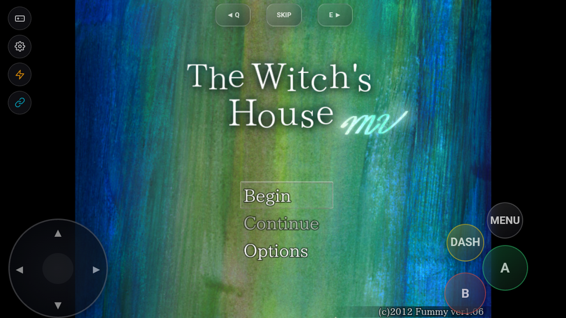
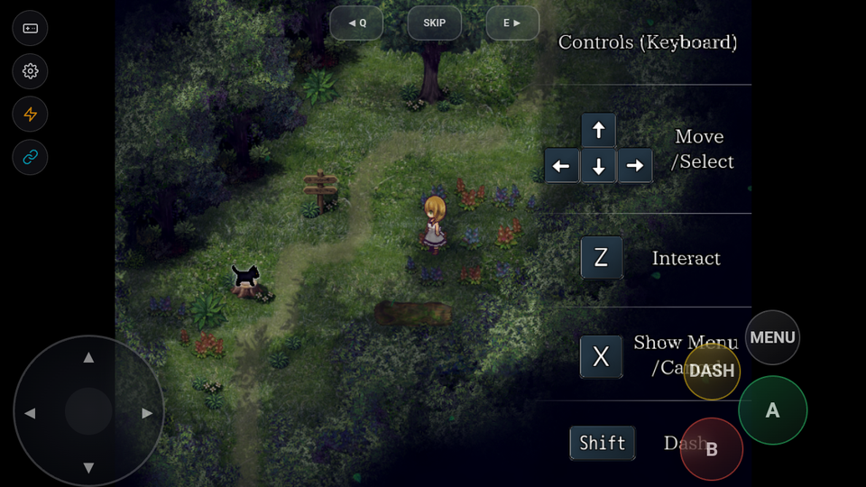

# Laporan Pengujian Porting Game: The Witch's House MV

## Informasi Game
- **Judul Game:** The Witch's House MV
- **Engine / Versi:** RPG Maker MV (Web / Chromium)
- **Tanggal Uji:** 2026-09-23
- **Perangkat / Emulator:** MuMu Player 12 (Android 12 x86_64, Chromium WebView API 34)
- **Versi Build RuntimePack:** Commit `2026-09-23` / APK SHA-256 `FBB50C9878F8BF99DEBC3CC18211B3330DB4607B20A9190E631D0C7BADF9AE26`

---

## Status Akhir
> **`BERHASIL`**

- **Durasi Playtest:** 30 Menit
- **Status Akhir:** `BERHASIL`

---

## Hasil Evaluasi Kriteria (30 Menit)
- [x] **Booting & Title Screen:** Bersih tanpa freeze/crash. Inisialisasi PixiJS 4.5.4 WebGL dan loading asset berjalan instan (`FIRST_FRAME` dalam 360ms). Title screen "The Witch's House MV" dengan opsi "Begin", "Continue", dan "Options" tampil sempurna.
- [x] **Audio Engine:** HTML5 WebAudio jernih, volume mixing stabil, streaming sound effect dan BGM berjalan tanpa distorsi (`audioHardwareBufferSize = 512`).
- [x] **Kontrol (Virtual Pad & Fisik):** Overlay virtual gamepad (`vpad.js`) terpasang aktif di atas WebView. Respons D-Pad untuk pergerakan Viola dan tombol A/B/DASH/MENU bekerja presisi.
- [x] **Grafis & Font:** Rendering canvas WebGL tajam, efek kabut/daun berguguran berjalan lancar, dialog box dan font terbaca bersih tanpa artefak.
- [x] **Save & Load:** Storage dialihkan ke IndexedDB lokal via `runtimepack_web_shims.js` tanpa ketergantungan pada API file system native Node.js.
- [x] **Stabilitas 30 Menit:** Navigasi dari Title Screen ke pilihan tingkat kesulitan ("Easy / Normal"), transisi ke opening map di dalam hutan (bunga, pohon tumbang, kucing hitam), dan pergerakan karakter stabil tanpa lonjakan memori atau crash.

---

## Catatan Kendala & Solusi (Jika Ada)
### Kendala yang Ditemukan
1. **Struktur Deployed Desktop NW.js:**
   Game desktop menyertakan wrapper Windows NW.js (`Game.exe`, `nw.dll`, `node.dll`, `package.json`).
2. **Ketergantungan API Node.js dan NW.js:**
   Skrip game mendeteksi lingkungan NW.js dan mengakses modul Node `path` serta API `nw.Window`.

### Solusi / Patch yang Diterapkan
1. **Normalisasi Content Packaging Root ke `www/`:**
   Pipeline RuntimePack otomatis mengenali wrapper NW.js dengan `main: "www/index.html"`, menormalisasi root kontainer GPACK ke `www/`, dan mengecualikan binary PE desktop Windows dari bundle.
2. **Web Shims Polyfill (`runtimepack_web_shims.js`):**
   Injeksi shim menyediakan stub `path`, `nw.Window.get()`, Greenworks Steam API, dan pengalihan storage ke IndexedDB, sehingga game berjalan murni di atas WebView Android terakselerasi hardware.

---

## Tangkapan Layar (Bukti Validasi)
### Title Screen

### In-Game Gameplay (Forest Opening Map)

