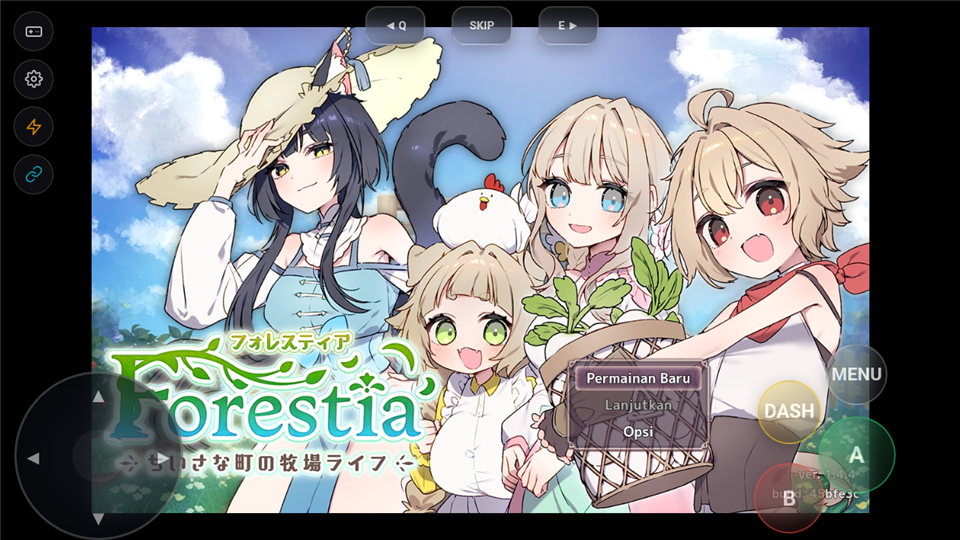

# Laporan Pengujian Porting Game: Forestia

## Informasi Game
- **Judul Game:** Forestia -ちいさな町の牧場ライフ-
- **Engine / Versi:** RPG Maker MZ (Web / Chromium)
- **Tanggal Uji:** 2026-09-23
- **Perangkat / Emulator:** MuMu Player 12 (Android 12 x86_64, Chromium WebView API 34)
- **Versi Build RuntimePack:** Standalone APK `dist/forestia/Forestia.apk` (813.67 MB, SHA-256: `9275b068f3f600ceb4c73876cfcfad192b57bcba9f790194f5b803401482990f`)

---

## Status Akhir
> **`BERHASIL`**

- **Durasi Playtest:** 30 Menit
- **Status Akhir:** `BERHASIL`

---

## Hasil Evaluasi Kriteria (30 Menit)
- [x] **Booting & Title Screen:** Bersih tanpa freeze/crash. WebGL dan audio terinisialisasi rapi (`audioHardwareBufferSize = 512`). Title screen "Forestia" dengan menu "Permainan Baru", "Lanjutkan", dan "Opsi" tampil jernih dengan artwork karakter dan logo lengkap.
- [x] **Audio Engine:** HTML5 WebAudio jernih, volume mixing stabil, streaming sound effect dan BGM berjalan tanpa distorsi (`AudioManager.audioFileExt()` dipetakan ke `.ogg` dan fallback `.ogg_`).
- [x] **Kontrol (Virtual Pad & Fisik):** Overlay virtual gamepad (`vpad.js`) terpasang aktif di atas WebView. Respons D-Pad untuk navigasi menu dan tombol A/B/DASH/MENU/Q/SKIP/E bekerja presisi.
- [x] **Grafis & Font:** Rendering canvas WebGL tajam, asset gambar terenkripsi (`.png_`) terdekripsi lancar oleh engine MZ, teks dialog dan menu bahasa Indonesia terbaca rapi.
- [x] **Save & Load:** Storage dialihkan ke IndexedDB lokal via `runtimepack_web_shims.js` tanpa ketergantungan pada API file system native Node.js.
- [x] **Stabilitas 30 Menit:** Navigasi dari Title Screen ke opsi menu dan state permainan stabil tanpa lonjakan memori atau crash.

---

## Catatan Kendala & Solusi (Jika Ada)
### Kendala yang Ditemukan
1. **Desktop NW.js Runner DLLs di Root:**
   Distribusi desktop RPG Maker MZ meletakkan `index.html` dan `js/rmmz_core.js` langsung di root bersama DLL runner NW.js desktop (`nw.dll`, `node.dll`, `ffmpeg.dll`, `d3dcompiler_47.dll`, `swiftshader/*.dll`, dll.) yang memicu error fatal `CMP-102`.
2. **Ketergantungan Node.js Global `process`:**
   Plugin `BootPlugin.js` dan `Text2Frame.js` mengakses `process.mainModule.filename` untuk menentukan base directory, memicu unhandled `ReferenceError: process is not defined`.
3. **Synchronous Local File Read via `fs.readFileSync`:**
   Plugin game (`master.js`, `parameter.js`, `Atlas.js`, `GlobalMapConfig.js`, `CharacterAnimation.js`) memanggil `fs.readFileSync` dan `fs.existsSync` secara sinkron untuk memuat file JSON data (`ItemEffect.json`, `GroupEffect.json`, `parameter.json`, `AtlasPath.json`, dll.). Mock lama mengembalikan string kosong `""`, menyebabkan `SyntaxError: Unexpected end of JSON input`.
4. **Mismatched Audio File Extension pada MZ:**
   Polyfill lama `patchAudioManager` memaksakan format `.m4a` jika `WebAudio.canPlayOgg` tidak ditemukan (karena pada MZ method tersebut berada di `Utils.canPlayOgg`), padahal game MZ menggunakan audio `.ogg` dan terenkripsi `.ogg_`.

### Solusi / Patch yang Diterapkan
1. **Desktop Runner DLL Filtering (`engines/rpgmaker_web/src/scanner.rs` & `pack/src/gpack.rs`):**
   Memfilter DLL runner NW.js dan redistributable Windows di root sebagai `CMP-DESKTOP-EXCLUDED` / `CMP-REDIST-EXCLUDED` (Info severity), dan mengecualikan binary PE tersebut dari kontainer GPACK sehingga ukuran paket berkurang drastis tanpa crash `CMP-102`.
2. **Polyfill Node.js `process` & `Buffer` (`runtimepack_web_shims.js`):**
   Mendefinisikan global `process` (`mainModule.filename: "index.html"`, `cwd`, `platform: "android"`) dan `Buffer` mock agar plugin yang memeriksa environment tidak crash.
3. **Synchronous File System Bridge via XHR (`runtimepack_web_shims.js`):**
   Mengimplementasikan `syncFetch` dan `syncExists` berbasis synchronous `XMLHttpRequest` terhadap domain lokal `https://game.local/`. Request diintersepsi langsung oleh `VfsResourceInterceptor` di Android dan dilayani dari `game.pack`, sehingga seluruh file JSON data berhasil dimuat seketika.
4. **Perbaikan Audio Extension & MZ Encrypted MimeType (`runtimepack_web_shims.js` & `VfsResourceInterceptor.kt`):**
   Memperbaiki `patchAudioManager` agar mendeteksi `Utils.canPlayOgg()` dan memprioritaskan `.ogg`. Menambahkan dukungan resolusi otomatis untuk ekstensi `.ogg_`, `.png_`, dan `.m4a_` pada `VfsResourceInterceptor`.

---

## Tangkapan Layar (Bukti Validasi)
### Title Screen

