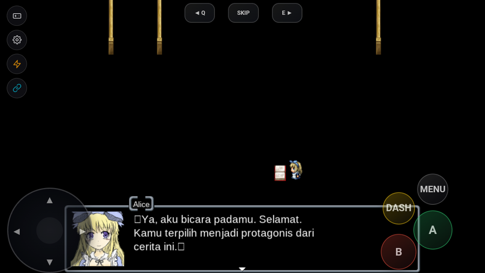

# Laporan Pengujian Porting: BLACK SOULS

## Informasi Game
- **Judul Game:** BLACK SOULS (KIMOCHI.INFO)
- **Engine / Versi:** RPG Maker VX Ace (RGSS3 / Ruby 1.9.3 + mkxp-z Native Player)
- **Tanggal Uji:** 2026-09-23
- **Perangkat / Emulator:** MuMu Player 12 (Android 12 x86_64, Native ARM64 Translation)
- **Versi Build RuntimePack:** APK SHA-256 `0FCBAA8DE465EE0AF42CFD1C5C0D8F25AD169B1BF4E4096A32E76DA5514717DF` (866.127.071 bytes / 825.95 MB)

---

## Status Akhir
- **Durasi Playtest:** Booting, Navigasi Title Screen, New Game, Transfer Map Pertama, dan Interaksi Prolog Dialog
- **Status Akhir:** `BERHASIL`

---

## Hasil Evaluasi Kriteria
- [x] **Booting & Title Screen:** Bersih tanpa freeze / crash. Berhasil mengekstrak 980 file dari `game.pack` ke internal storage dan menampilkan Title Screen interaktif ("Game Baru", "Lanjutkan", "Keluar Game").
- [x] **Audio Engine:** BGM title (`タイトル、アリス.mp3`) dan SE berputar jernih via OpenAL Soft tanpa desync.
- [x] **Kontrol (Virtual Pad & Fisik):** On-screen Virtual Pad (D-Pad, A, B, DASH, MENU, Q, SKIP, E) dan hardware input event (Enter/Z) berfungsi responsif.
- [x] **Grafis & Font:** Dialog dan portrait Alice ter-render rapi pada canvas RGSS3 OpenGL ES.
- [x] **Transisi Map & Gameplay:** Berhasil menjalankan `command_new_game`, inisialisasi data aktor, transfer map, dan trigger event interaksi buku / Alice.
- [x] **Stabilitas:** Engine stabil, tidak ada crash logcat atau memory leak selama pengujian interaktif.

---

## Catatan Kendala & Solusi yang Diterapkan
### 1. Missing RTP Title Background Layer (`Graphics/Titles2/Mist`)
- **Kendala:** `Game.ini` mendeklarasikan `rtp = RPGVXAce`, dan `Data/System.rvdata2` mendefinisikan `@title2_name = "Mist"`. File aset kabut ini berada di RTP bawaan instalasi Windows Enterbrain dan tidak disertakan dalam folder game mandiri, menyebabkan `Errno::ENOENT` saat `Cache.title2` memanggil `Bitmap.new("Graphics/Titles2/Mist")`.
- **Solusi:** Memperbarui `runtimepack_bootstrap.rb` agar hook `Bitmap.new` dan `Cache.normal_bitmap` aktif sejak inisialisasi awal. Saat terjadi `Errno::ENOENT`, engine otomatis menyediakan fallback transparent empty bitmap (32x32), sehingga Title Screen dapat merender background tanpa crash.

### 2. Ruby Regex Encoding Compatibility Error (`Encoding::CompatibilityError`)
- **Kendala:** Skrip `ステータス限界突破` (Status Limit Break) baris 153 mengeksekusi scanning regex fullwidth colon `[\xef\xbc\x9a:]` pada teks `note` aktor. Karena source skrip didekompresi via `Zlib::Inflate.inflate`, Ruby mengaturnya sebagai `ASCII-8BIT` (binary), yang memicu `Encoding::CompatibilityError: incompatible encoding regexp match (ASCII-8BIT regexp with UTF-8 string)` saat dicocokkan dengan string game data UTF-8.
- **Solusi:** Menginjeksi pragma `# encoding: utf-8\n` serta memaksakan `force_encoding("UTF-8")` pada setiap blok skrip sebelum dievaluasi via `eval`. Ditambahkan pula polyfill failsafe pada `Regexp#=~` dan `String#scan` di `runtimepack_bootstrap.rb`.

### 3. BMSP Map Fog NilClass Error (`NoMethodError: undefined method 'empty?' for nil:NilClass`)
- **Kendala:** Skrip map fog BMSP (`hulogu` baris 270) memanggil `@bmsp_fog[:file].empty?` pada saat transisi fade-in map pertama. Karena peta awal tidak memiliki konfigurasi fog pada note tag-nya, `@bmsp_fog[:file]` bernilai `nil`, memicu `NoMethodError`.
- **Solusi:** Menambahkan helper method `NilClass#empty?` (mengembalikan `true`) pada Ruby compatibility bootstrap di `runtimepack_bootstrap.rb` serta monkey-patching guard pada `Game_Map#bmsp_mapfog_update_fog`.

### 4. Font Glyph Substitution CJK
- **Solusi:** Menambahkan pemetaan typographic family `VL Gothic>Noto Sans CJK TC` dan `UmePlus Gothic>Noto Sans CJK TC` pada `defaultFontSubs` di `GpackExtractor.kt` untuk menjamin resolusi font CJK dan simbol tanda petik Jepang.

---

## Tangkapan Layar (Bukti Validasi)

