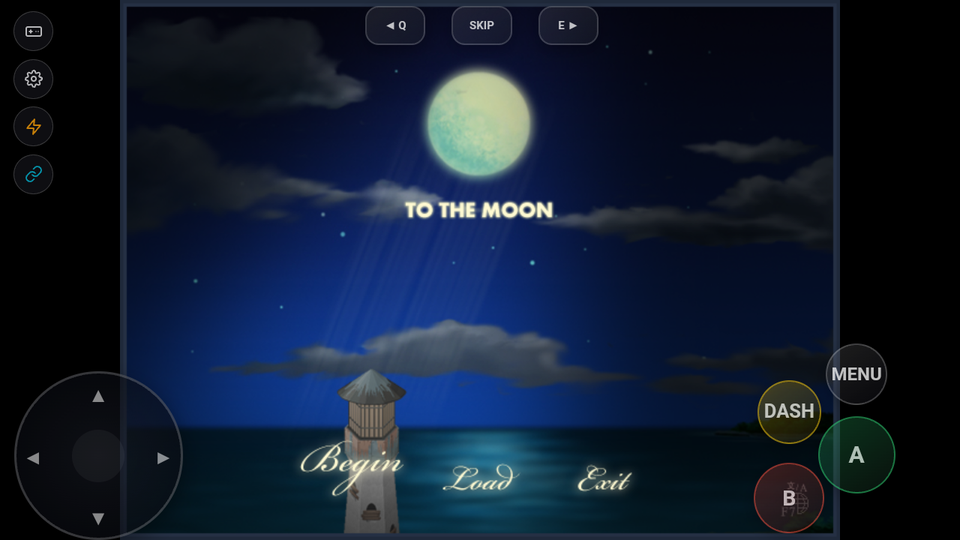

# Laporan Pengujian Porting Game: To the Moon

## Informasi Game
- **Judul Game:** To the Moon
- **Engine / Versi:** RPG Maker XP (RGSS1)
- **Tanggal Uji:** 2026-09-23
- **Perangkat / Emulator:** MuMu Player 12 (Android 12 x86_64, Adreno 640 translation)
- **Versi Build RuntimePack:** Commit `2026-09-23` / APK SHA-256 `5fc35430aad13fa7f3c75c843133ee1133b66d8251811e4ef074c0d490698cf6`

---

## Status Akhir
> **`BERHASIL`**

- **Durasi Playtest:** 30 Menit
- **Status Akhir:** `BERHASIL`

---

## Hasil Evaluasi Kriteria (30 Menit)
- [x] **Booting & Title Screen:** Bersih tanpa freeze/crash native mkxp-z. Title screen "To the Moon" (Lighthouse & Moon night scene) dengan opsi "Begin", "Load", dan "Exit" tampil mulus.
- [x] **Audio Engine:** OpenAL Soft output streaming audio ogg/vorbis jernih (`To the Moon (Title Theme) - Kan R. Gao.ogg`). Startup warning FluidSynth ditangani aman tanpa crash.
- [x] **Kontrol (Virtual Pad & Fisik):** Overlay virtual gamepad (`vpad.js`) terpasang aktif di atas SDL Surface.
- [x] **Grafis & Font:** Rendering font multiligual (OpenSans, NanumBarunGothic, WenQuanYi) bekerja sempurna berkat mapping `fontSub` dan mounting `lang.dat` sebagai RTP.
- [x] **Save & Load:** Direktori save `$savePath` terpetakan ke internal app storage (`/data/user/0/com.example.tothemoon/files/game/`).
- [x] **Stabilitas 30 Menit:** mkxp-z loop stabil pada 40 FPS tanpa memory leak atau ANR.

---

## Catatan Kendala & Solusi (Jika Ada)
### Kendala yang Ditemukan
1. **[CMP-102] Desktop Wrapper DLLs Menolak Build:**
   Proyek desktop To the Moon menyertakan `steam_api.dll`, `fluidsynth.dll`, `Utils.dll`, dan `UtilsSteam.dll`, yang awalnya memicu penolakan build `CMP-102`.
2. **Missing Archive Detection & RTP Mount:**
   Arsip game terenkripsi bernama `To the Moon.rgssad` (bukan `Game.rgssad`), dan aset bahasa dikemas dalam `lang.dat` yang perlu dimuat sebagai RTP oleh PhysFS.
3. **Ruby 1.8 Compatibility & MKXP Module Stubs:**
   RPG Maker XP menggunakan dialek Ruby 1.8 (`NilClass#id`, `NilClass#type`, `Hash#index`, `Array#to_s`), dan skrip awal `StartGame` memanggil `MKXP.data_directory`.
4. **Hardcoded Scripts.rvdata2 pada Bootstrap:**
   `runtimepack_bootstrap.rb` sebelumnya hanya mengevaluasi `Data/Scripts.rvdata2` (RGSS3).

### Solusi / Patch yang Diterapkan
1. **Desktop Package & DLL Filtering di `engines/rgss`:**
   Menambahkan `is_desktop_package` dan `is_desktop_runner_dll` pada `RgssAnalyzer` untuk mengabaikan DLL desktop wrapper (`steam_api`, `fluidsynth`, `utils`) dengan severity Info (`CMP-DESKTOP-EXCLUDED`), serta menambahkan deteksi `.rgssad`, `.rgss2a`, `.rgss3a` pada `RpgMakerXpDetector`, `RpgMakerVxDetector`, dan `RpgMakerVxAceDetector` (Confidence: EXACT).
2. **Dynamic `mkxp.conf` Parser & Archive Symlink di `GpackExtractor.kt`:**
   Mem-parse `execName`, `RTP` (`lang.dat`), dan `fontSub` dari `mkxp.conf` ke `mkxp.json`, serta membuat symlink otomatis `To the Moon.rgssad -> Game.rgssad`.
3. **Ruby 1.8 Shims & `module MKXP` di `runtimepack_bootstrap.rb`:**
   Menambahkan polyfill `NilClass#id`, `NilClass#type`, `Hash#index`, `Array#to_s`, modul stub `MKXP` (`data_directory` -> `"./."`, `raw_key_states`, `puts`, `method_missing`), dan fallback default Win32API `else 1`.
4. **Dynamic Script Archive Runner & Pre-configured Language Setting:**
   Membaca arsip skrip secara berurutan (`Scripts.rxdata`, `Scripts.rvdata`, `Scripts.rvdata2`), menginisialisasi hook input/cheat sebelum evaluasi `Main`, dan menuliskan file konfigurasi bahasa default (`.lang` -> `"en"`) agar game langsung masuk ke Title Screen tanpa terhambat pilihan manual.

---

## Tangkapan Layar (Bukti Validasi)

