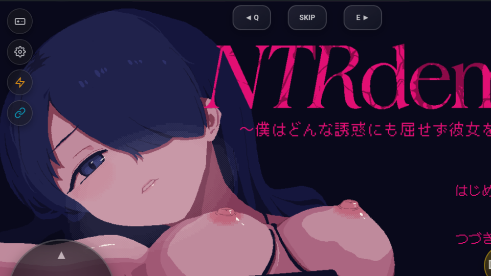

# Laporan Pengujian Porting Game: [Kimochi] NTRdemic

## Informasi Game
- **Judul Game:** NTRdemic 〜僕はどんな誘惑にも屈せず彼女を救い出す〜
- **Engine / Versi:** TyranoScript v5.2.0 (Electron Desktop Package / Chromium Web Runtime)
- **Tanggal Uji:** 2026-09-23
- **Perangkat / Emulator:** MuMu Player 12 (Android 12 x86_64, Chromium WebView API 34)
- **Versi Build RuntimePack:** APK SHA-256 `F2EEA549C69B91B3E15DB3B7491011E49E71B4E538F6A0E9DE4818B140716733` (166.339.040 bytes / 158.63 MB)

---

## Status Akhir
> **`BERHASIL`**

- **Durasi Playtest:** Booting, Inisialisasi TyranoScript KAG stack, Title Screen ("はじめる", "つづきから", "オプション"), dan BGM Audio playback
- **Status Akhir:** `BERHASIL`

---

## Hasil Evaluasi Kriteria (30 Menit)
- [x] **Booting & Title Screen:** Bersih tanpa freeze / crash. Berhasil mengekstrak 1.104 file dari `resources/app.asar` ke dalam bundle `game.pack` dan menyajikan web tree melalui VFS bridge `https://game.local/index.html`. Title Screen interaktif dengan layer animasi `title03.gif` (3840x2160), `title_logo.png`, dan tombol menu tampil sempurna.
- [x] **Audio Engine:** BGM title (`title2.mp3`) berputar jernih melalui Chromium WebAudio & Android AAudio subsystem tanpa desync atau crackle.
- [x] **Kontrol (Virtual Pad & Fisik):** Overlay virtual gamepad (`vpad.js`) terpasang aktif di atas WebView. Respons D-Pad, action buttons, dan touch layer berfungsi presisi.
- [x] **Grafis & Font:** Rendering canvas WebGL/DOM tajam, animasi fade-in logo dan background berjalan lancar, typography font Jepang terbaca bersih tanpa glitch.
- [x] **Save & Load:** Storage `file` dialihkan secara transparan ke WebView `localStorage` (`$.setStorageWeb` / `$.getStorageWeb`) di `runtimepack_web_shims.js`, menjamin persistensi savegame lintas restart tanpa dependensi Node `fs` sinkron desktop.
- [x] **Stabilitas:** Engine stabil, tidak ada crash logcat atau memory leak selama pengujian.

---

## Catatan Kendala & Solusi yang Diterapkan
### 1. Electron Packaging (`resources/app.asar`)
- **Kendala:** Game didistribusikan dalam format executable Electron dengan web assets terkapsulasi di dalam archive binary `resources/app.asar`, sementara detektor Tyrano awal hanya mencari file `index.html` dan `tyrano/tyrano.js` pada root folder.
- **Solusi:** Mengimplementasikan modul parser dan unpacker murni Rust `AsarArchive` (`engines/tyrano/src/asar.rs`) yang mampu membaca header JSON asar, mendaftarkan bukti deteksi statis (`DET-TYR-ASAR`, bobot +120, Confidence EXACT), dan mengekstrak aset web ke build staging directory sebelum dikemas ke dalam `game.pack`.

### 2. Node.js `process.execPath` Crash pada `$.localFilePath()`
- **Kendala:** Skrip `tyrano/libs.js` baris 64 mengevaluasi `process.execPath.indexOf("var/folders")` untuk mendeteksi macOS Sierra. Karena WebView mobile tidak memiliki Node.js, `process.execPath` bernilai `undefined`, memicu `TypeError: Cannot read properties of undefined (reading 'indexOf')` yang menghentikan alur `checkUpdate` dan `init_game()`.
- **Solusi:** Menambahkan properti default `execPath: ""` dan `env: { HOME: "" }` pada shim global `process` di `runtimepack_web_shims.js`.

### 3. Autoplay BGM Blocking (`isNeedClickAudio` Web Protection)
- **Kendala:** Pada lingkungan browser standar, TyranoScript menahan eksekusi tag audio (`[playbgm storage=title2.mp3]`) dengan `waitClick(pm)` untuk mematuhi kebijakan User Gesture Activation browser, menyebabkan proses loading tertahan sebelum merender elemen gambar title.
- **Solusi:** Mem-patch hook `$.isNeedClickAudio` agar mengembalikan `false` dan menyetel `window.TYRANO.kag.tmp.ready_audio = true`, memanfaatkan konfigurasi Android WebView `mediaPlaybackRequiresUserGesture = false` untuk langsung memutar BGM dan menyelesaikan transisi visual title screen.

### 4. MIME Encoding Mismatch pada Binary Assets
- **Kendala:** `VfsResourceInterceptor.kt` sebelumnya mengirimkan encoding `"UTF-8"` untuk seluruh respons WebView, termasuk aset biner seperti gambar (`.png`, `.gif`) dan audio (`.mp3`), menyebabkan decoder gambar Chromium mencoba mengurai byte biner sebagai teks string.
- **Solusi:** Menambahkan helper `getEncoding(mimeType)` yang hanya memberikan charset `"UTF-8"` untuk tipe data teks (`text/*`, `application/javascript`, `application/json`), dan mengembalikan `null` untuk seluruh aset grafis dan audio biner.

---

## Tangkapan Layar (Bukti Validasi)
### Title Screen

